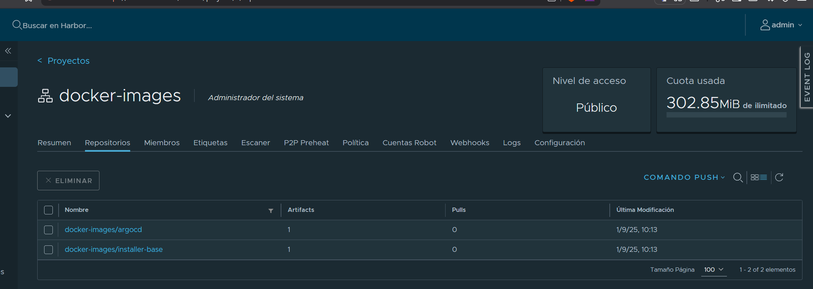

**English** | [Español](./Readme.es.md)

# ArgoCD Custom Image - AVP Baked In


Custom ArgoCD image with `argocd-vault-plugin` (AVP) built in, needed because the official image does not include `curl`/`wget` to download the binary at runtime.

## Build Order

### 1. Download the AVP Binary
Download on `pve-1` (it has internet access), since the ArgoCD base image has no download tools:
```bash
wget https://github.com/argoproj-labs/argocd-vault-plugin/releases/download/v1.18.1/argocd-vault-plugin_1.18.1_linux_amd64
```

### 2. Build the Image
**Folder**: [`./`](./)
```bash
cd infrastructure-applications/argocd-docker-build/
docker build -t registry.harbor.local/docker-images/argocd:v3.5.2-custom .
```

The `Dockerfile`:
- `COPY`s the manually downloaded AVP binary (no `curl` during build)
- Runs `update-ca-certificates` with the Harbor CA baked in, for internal TLS pull/push

### 3. Push to Harbor
```bash
docker push registry.harbor.local/docker-images/argocd:v3.5.2-custom
```

## Readiness State

After the build you will have:
- **ArgoCD image** with AVP 1.18.1 embedded
- **Harbor CA** trusted inside the container
- **Image published** at `registry.harbor.local/docker-images/argocd:v3.5.2-custom`

## Verification

```bash
# Exec into the avp sidecar of the repo-server
kubectl exec -it <argocd-repo-server-pod> -c avp -n argocd -- sh

# Inside the pod, against a test manifest with <path:secret/data/test#hello>
argocd-vault-plugin generate .
# Must resolve to: world
```



## Next Step

Once the image is in Harbor, go to:
- **`../argocd/`** - Reference the image in the repo-server `values.yaml`

## Dependencies

- **Step 1** requires internet access (only available on `pve-1`)
- **Step 3** requires Harbor running and login configured
- **`../argocd/`** requires this image published before it can resolve OpenBao secrets
