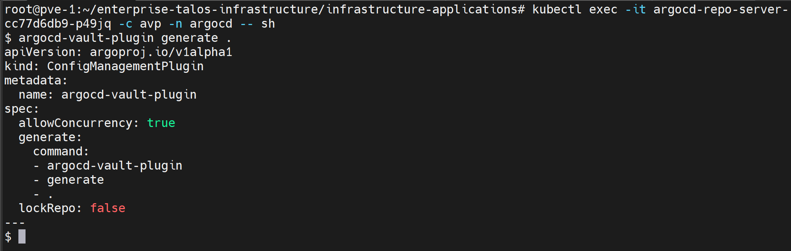
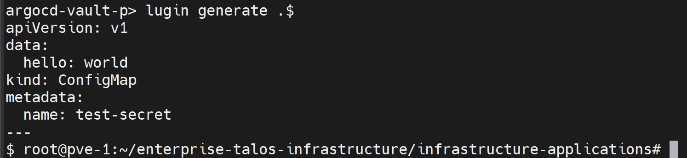
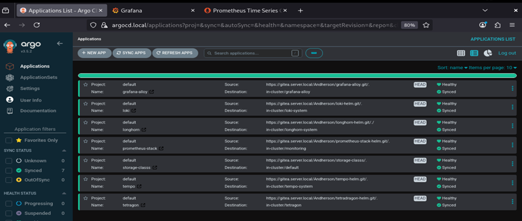

**English** | [Español](./Readme.es.md)

# ArgoCD - GitOps Controller


ArgoCD wrapper chart in HA mode, with `argocd-vault-plugin` (AVP) integrated as a repo-server sidecar to resolve secrets from OpenBao at sync time.

## Components

| Component | Detail |
|-----------|--------|
| Base chart | `argo-cd` 10.4.2 (appVersion `v3.5.2`), via OCI from `oci://registry.harbor.local/helm-charts` |
| Image | `registry.harbor.local/docker-images/argocd:v3.5.2-custom` (see [`../argocd-docker-build/`](../argocd-docker-build/)) |
| Redis | `redis-ha` (Sentinel), replaces the default standalone `redis` |
| Dex | `registry.harbor.local/proxy-ghcr/dexidp/dex:v2.45.1` |
| Secrets | AVP sidecar on `repoServer`, resolves `<path:secret/data/...#key>` against OpenBao |

## High Availability

- `controller`, `server` and `repoServer`: **2 replicas** each, with `podAntiAffinity` (preferred) on `kubernetes.io/hostname` — keeps both replicas of a component off the same node
- `redis-ha`: Sentinel enabled (`redis.enabled: false`, `redis-ha.enabled: true`)
- Scheduling: the whole release uses `nodeSelector: workload-type: infrastructure` + `PreferNoSchedule` toleration

## TLS: Terminated at the Gateway

`server.insecure: true` and `*.repo.server.plaintext: "true"` because TLS is terminated at the Gateway API (`../gateway-api/`), not inside ArgoCD. This chart's `templates/https.yaml` exposes the matching `HTTPRoute`/`Certificate` — ArgoCD itself runs in plain text inside the cluster.

## AVP + OpenBao Integration

The `avp` sidecar on `repoServer`:
- Image: the same custom one (`v3.5.2-custom`) with the AVP binary baked in
- Mounts the OpenBao CA (`templates/openbao-ca-configmap.yaml`) at `/vault/tls`
- Mounts the plugin config (`templates/cmp-plugin-configmap.yaml`) at `/home/argocd/cmp-server/config/plugin.yaml`
- Takes `VAULT_ADDR` and the AppRole credentials from `templates/vault-configuration-secret.yaml` (`envFrom.secretRef: vault-configuration`)

## Deployment Order

### 1. Prerequisites
- Custom image published — see [`../argocd-docker-build/`](../argocd-docker-build/)
- OpenBao cluster initialized and AppRole configured — see [`../../services/openbao-server/`](../../services/openbao-server/)

### 2. Configure the Vault Secret
`templates/vault-configuration-secret.yaml` requires `VAULT_ADDR` (OpenBao HAProxy endpoint) and the AppRole credentials:
```bash
# VAULT_ADDR=https://192.168.253.34:8200
```

### 3. Install/Upgrade the Release
```bash
cd infrastructure-applications/argocd/
helm dependency update
helm upgrade --install argocd . -n argocd --create-namespace
```

## Readiness State

After the deployment you will have:
- **HA ArgoCD** with 2 replicas per critical component
- **Manifest sync** resolving OpenBao secrets in real time via AVP
- **TLS terminated at the Gateway**, ArgoCD serving plain text internally

## Operational Note: OpenBao Dependency

If OpenBao gets sealed (for example, after rebooting the cluster VMs), the AVP sidecar fails with `503` when logging in via AppRole. Check and unseal OpenBao before assuming the problem is in ArgoCD — see [`../../services/openbao-server/`](../../services/openbao-server/).

## Verification

```bash
# Pods Running, 2 replicas per component
kubectl get pods -n argocd

# Confirm secret resolution from the avp sidecar
kubectl exec -it <argocd-repo-server-pod> -c avp -n argocd -- sh
argocd-vault-plugin generate .
# Must resolve <path:secret/data/test#hello> → world
```

## Evidence





*Successful resolution of `<path:secret/data/test#hello>` → `world` from the repo-server AVP sidecar, confirming the full pipeline: ArgoCD → HAProxy → OpenBao leader.*



## Next Step

With ArgoCD running, apply the `Application`s from [`../argocd-applications/`](../argocd-applications/Readme.md) (grafana-alloy, loki, longhorn, storage-classes, prometheus-stack, tempo, tetragon, otel-demo), which are synced through this controller.

## Dependencies

- **Step 2** requires OpenBao initialized and an AppRole with a read-only policy (`../../services/openbao-server/`)
- **Step 3** requires the custom image published in Harbor (`../argocd-docker-build/`)
