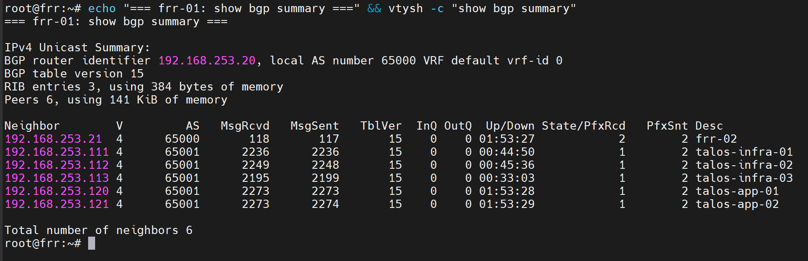
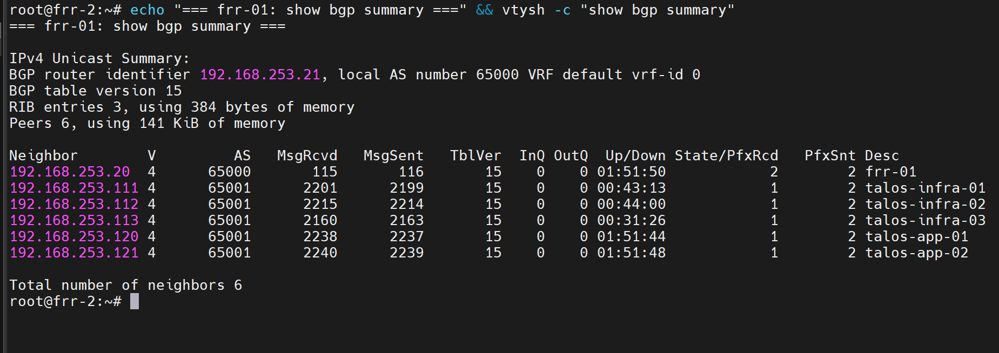
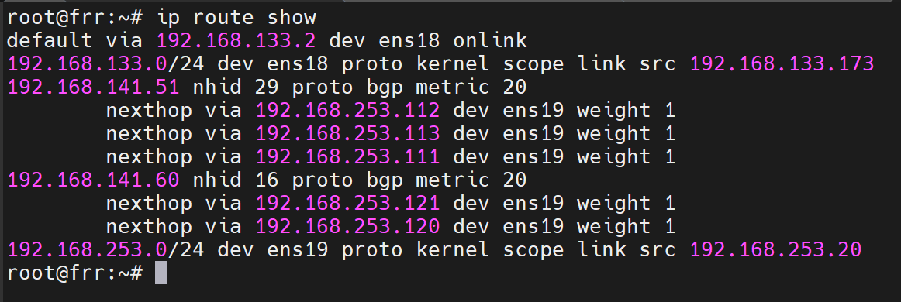
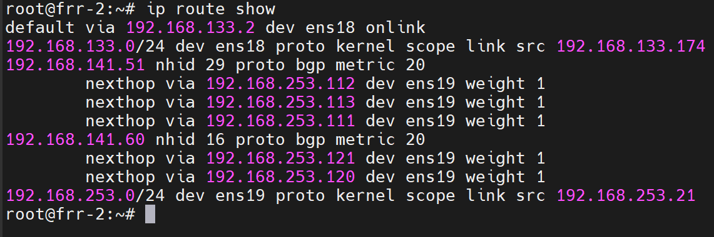
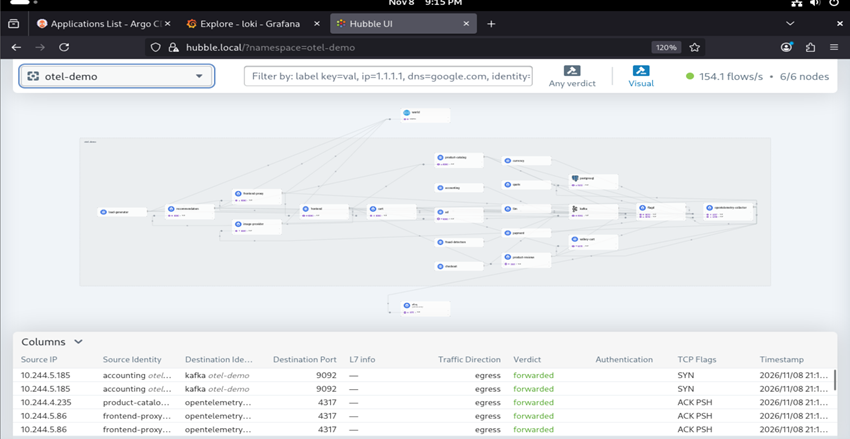

**English** | [Español](./Readme.es.md)

# Cilium - CNI + BGP Control Plane


Cilium wrapper chart as the cluster CNI, with the BGP Control Plane advertising the Gateways' LoadBalancer IPs via ECMP towards FRR, replacing L2 announcements.

## Components

| Component | Detail |
|-----------|--------|
| Base chart | `cilium` 1.20.1, via OCI from `oci://registry.harbor.local/helm-charts` |
| Routing mode | Native, `autoDirectNodeRoutes`, `netkit` datapath |
| kube-proxy | Replaced (`kubeProxyReplacement: true`) |
| Load Balancer | `hybrid` mode, `maglev` algorithm |
| Bandwidth Manager | BBR enabled |
| Hubble | UI + Relay enabled, auto TLS (Helm method) |
| Gateway API | Enabled, CRDs installed |

## BGP (`bgp/`)

BGP Control Plane instead of L2 announcements, to advertise LoadBalancer IPs with ECMP.

| Resource | Detail |
|----------|--------|
| `bgp-cluster-infra.yaml` | `CiliumBGPClusterConfig` for `workload-type: infrastructure` nodes, local ASN 65001 |
| `bgp-cluster-app.yaml` | `CiliumBGPClusterConfig` for `workload-type: application` nodes, local ASN 65001 |
| `bgp-peer-config-infra.yaml` / `bgp-peer-config-app.yaml` | `CiliumBGPPeerConfig` — graceful restart, timers, advertisement selector by label |
| `bgp-advertisement-infra.yaml` / `bgp-advertisement-app.yaml` | `CiliumBGPAdvertisement` — advertises the `LoadBalancerIP` of Services matching `infra-gateway` / `apps-gateway` |

BGP peers (ASN 65000):
- `frr-01` — `192.168.253.20`
- `frr-02` — `192.168.253.21`

## Routes (`routes/`)

- `https.yaml` — `HTTPRoute` exposing the Hubble UI (`hubble.local`) via `infra-gateway`, with HTTP → HTTPS redirect

## Deployment Order

### 1. Prerequisites
- FRR (`frr-01`/`frr-02`) deployed and configured as BGP peer in AS 65000
- Gateway API CRDs installed (Gateways and IP pools are created afterwards, see `../gateway-api/`)

### 2. Install/Upgrade the Release
```bash
cd infrastructure-applications/cilium/
helm dependency update
helm upgrade --install cilium . -n kube-system
```

## Readiness State

After the deployment you will have:
- **Cilium** as the only CNI, without kube-proxy
- **BGP Control Plane** advertising LoadBalancer IPs via ECMP towards FRR
- **Hubble UI** reachable at `hubble.local` via Gateway API

### Evidence

Each FRR with 6 `Established` peers: the other FRR (AS 65000) and the 5 Cilium nodes (AS 65001):




ECMP routes installed in FRR: `192.168.141.51` (infra-gateway, 3 infra nexthops) and `192.168.141.60` (apps-gateway, 2 app nexthops):






## Verification

```bash
# BGP peer status
cilium bgp peers

# Advertised routes
cilium bgp routes

# Cilium pods Running
kubectl get pods -n kube-system -l k8s-app=cilium
```

## Next Step

With Cilium and BGP running, the LoadBalancer Services of the rest of `infrastructure-applications/` become reachable through the IPs advertised to FRR.

## Dependencies

- **Step 1** requires FRR configured as BGP peer (on `frr-01`/`frr-02`, see `../../services/frr-server/`)
- **Gateway API** (`../gateway-api/`) is required before the `CiliumBGPAdvertisement` resources have anything to advertise
