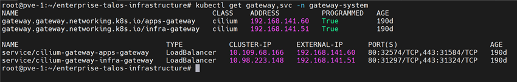

[English](./Readme.md) | **Español**

# Gateway API - Gateways e IP Pools


Gateways de entrada del cluster implementados por Cilium (`gatewayClassName: cilium`), con IPs fijas asignadas por LB IPAM y anunciadas por BGP hacia FRR. Todas las `HTTPRoute` de las apps se cuelgan de estos Gateways.

## Gateways

| Gateway | IP | Pool | Uso |
|---------|-----|------|-----|
| `infra-gateway` | `192.168.141.51` | `infrastructure-pool` | UIs de plataforma (Grafana, Prometheus, Longhorn, Hubble, ArgoCD, Alloy...) |
| `apps-gateway` | `192.168.141.60` | `application-pool` | Aplicaciones de negocio |

Ambos con los mismos listeners:

| Listener | Puerto | Hostname | Detalle |
|----------|--------|----------|---------|
| `https` | 443 | `*.local` | TLS terminado con el secret `infra-tls` |
| `http` | 80 | `*.local` | Usado por las routes de redirect HTTP → HTTPS |

`allowedRoutes: All`: acepta `HTTPRoute` de cualquier namespace.

## IP Pools (Cilium LB IPAM)

| Archivo | Pool | CIDR |
|---------|------|------|
| `ip-pool-infra.yaml` | `infrastructure-pool` | `192.168.141.51/32` |
| `ip-pool-app.yaml` | `application-pool` | `192.168.141.60/32` |
| `ip-pool-infra-talos.yaml` | `syslog-pool` | `192.168.141.52/32` (endpoint de logs de Talos hacia Alloy, TCP `5140`) |

Las IPs de los Gateways se anuncian vía BGP (ver `../cilium/bgp/`).

## Certificado TLS

`infra-secret.yaml` contiene el certificado wildcard `*.local` firmado por la CA de mkcert. **La llave privada es un placeholder (`CHANGE_ME`)**: no se versiona.

Crear el secret con la llave real (generada en `requirements/certificate-server-config/`, salida en `/opt/generated_certs/wildcard-local/`):

```bash
kubectl create secret tls infra-tls -n gateway-system \
  --cert=wildcard-local.pem --key=wildcard-local.key \
  --dry-run=client -o yaml | kubectl apply -f -
```

## Orden de Despliegue

### 1. Requisitos previos
- Cilium instalado con Gateway API habilitado (`../cilium/`) — provee la `GatewayClass` `cilium` y los CRDs de LB IPAM
- BGP de Cilium configurado hacia FRR

### 2. Aplicar los manifiestos
```bash
cd infrastructure-applications/gateway-api/
kubectl apply -f namespace.yaml
kubectl apply -f ip-pool-infra.yaml -f ip-pool-app.yaml -f ip-pool-infra-talos.yaml
```

### 3. Crear el secret TLS
Con el comando de la sección anterior (no aplicar `infra-secret.yaml` tal cual, la llave es un placeholder).

### 4. Crear los Gateways
```bash
kubectl apply -f infra-gateway.yaml -f app-gateway.yaml
```

## Estado de Preparación

Al completar el despliegue tendrás:
- `infra-gateway` en `192.168.141.51` y `apps-gateway` en `192.168.141.60`
- HTTPS con certificado wildcard `*.local`
- IPs anunciadas por BGP y alcanzables desde la red vía FRR

## Verificación

```bash
kubectl get gateway -n gateway-system
```

```bash
kubectl get ciliumloadbalancerippool
```

```bash
kubectl get svc -n gateway-system
```

Las dos columnas `PROGRAMMED` deben estar en `True` y las IPs asignadas.



## Dependencias

- **Cilium** (`../cilium/`) con Gateway API y BGP
- **Certificado wildcard** (`../../requirements/certificate-server-config/`)
- **DNS/hosts**: los `*.local` deben resolver a `192.168.141.51` (infra) o `192.168.141.60` (apps)
