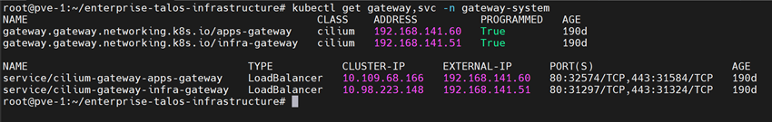

**English** | [Español](./Readme.es.md)

# Gateway API - Gateways and IP Pools


Cluster ingress Gateways implemented by Cilium (`gatewayClassName: cilium`), with fixed IPs assigned by LB IPAM and advertised via BGP towards FRR. Every app `HTTPRoute` attaches to these Gateways.

## Gateways

| Gateway | IP | Pool | Usage |
|---------|-----|------|-------|
| `infra-gateway` | `192.168.141.51` | `infrastructure-pool` | Platform UIs (Grafana, Prometheus, Longhorn, Hubble, ArgoCD, Alloy...) |
| `apps-gateway` | `192.168.141.60` | `application-pool` | Business applications |

Both share the same listeners:

| Listener | Port | Hostname | Detail |
|----------|------|----------|--------|
| `https` | 443 | `*.local` | TLS terminated with the `infra-tls` secret |
| `http` | 80 | `*.local` | Used by the HTTP → HTTPS redirect routes |

`allowedRoutes: All`: accepts `HTTPRoute`s from any namespace.

## IP Pools (Cilium LB IPAM)

| File | Pool | CIDR |
|------|------|------|
| `ip-pool-infra.yaml` | `infrastructure-pool` | `192.168.141.51/32` |
| `ip-pool-app.yaml` | `application-pool` | `192.168.141.60/32` |
| `ip-pool-infra-talos.yaml` | `syslog-pool` | `192.168.141.52/32` (Talos logs endpoint towards Alloy, TCP `5140`) |

The Gateway IPs are advertised via BGP (see `../cilium/bgp/`).

## TLS Certificate

`infra-secret.yaml` contains the `*.local` wildcard certificate signed by the mkcert CA. **The private key is a placeholder (`CHANGE_ME`)**: it is not versioned.

Create the secret with the real key (generated in `requirements/certificate-server-config/`, output in `/opt/generated_certs/wildcard-local/`):

```bash
kubectl create secret tls infra-tls -n gateway-system \
  --cert=wildcard-local.pem --key=wildcard-local.key \
  --dry-run=client -o yaml | kubectl apply -f -
```

## Deployment Order

### 1. Prerequisites
- Cilium installed with Gateway API enabled (`../cilium/`) — provides the `cilium` `GatewayClass` and the LB IPAM CRDs
- Cilium BGP configured towards FRR

### 2. Apply the manifests
```bash
cd infrastructure-applications/gateway-api/
kubectl apply -f namespace.yaml
kubectl apply -f ip-pool-infra.yaml -f ip-pool-app.yaml -f ip-pool-infra-talos.yaml
```

### 3. Create the TLS secret
Use the command from the previous section (do not apply `infra-secret.yaml` as is, the key is a placeholder).

### 4. Create the Gateways
```bash
kubectl apply -f infra-gateway.yaml -f app-gateway.yaml
```

## Readiness State

After the deployment you will have:
- `infra-gateway` at `192.168.141.51` and `apps-gateway` at `192.168.141.60`
- HTTPS with the `*.local` wildcard certificate
- IPs advertised via BGP and reachable from the network through FRR

## Verification

```bash
kubectl get gateway -n gateway-system
```

```bash
kubectl get ciliumloadbalancerippool
```

```bash
kubectl get svc -n gateway-system
```

Both `PROGRAMMED` columns must be `True` and the IPs assigned.



## Dependencies

- **Cilium** (`../cilium/`) with Gateway API and BGP
- **Wildcard certificate** (`../../requirements/certificate-server-config/`)
- **DNS/hosts**: `*.local` must resolve to `192.168.141.51` (infra) or `192.168.141.60` (apps)
