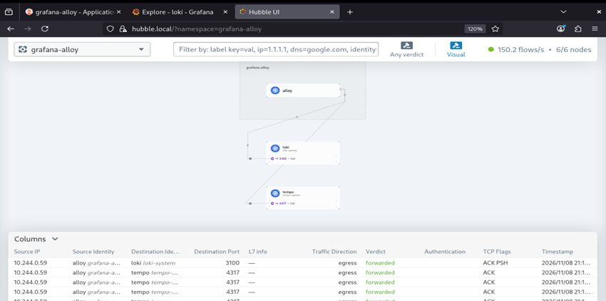

[English](./Readme.md) | **Español**

# Grafana Alloy - Telemetry Pipeline


Wrapper chart de Grafana Alloy como colector unificado de telemetría: logs de pods y del sistema Talos hacia Loki, y trazas OTLP hacia Tempo. Sin montajes `hostPath`, compatible con Talos Linux.

## Pipeline

| Fuente | Entrada | Destino |
|--------|---------|---------|
| Logs de pods | Kubernetes API (`loki.source.kubernetes`) | Loki |
| Logs del sistema Talos | TCP `192.168.141.52:5140` (`json_lines`, `otelcol.receiver.tcplog`) | Loki |
| Trazas de apps | OTLP gRPC `:4317` / HTTP `:4318` | Tempo |
| Logs OTLP de apps | OTLP gRPC `:4317` / HTTP `:4318` | Loki |

Labels de logs de pods: `namespace`, `pod`, `container`, `app`, `node`, `cluster`. Labels de logs de Talos: `job="talos-system"`, `service`, `level`, `node`, `cluster`.

| Destino | Endpoint |
|---------|----------|
| Loki | `http://loki.loki-system.svc.cluster.local:3100/loki/api/v1/push` |
| Tempo | `tempo.tempo-system.svc.cluster.local:4317` (sin TLS) |

## Componentes

| Componente | Detalle |
|------------|---------|
| Chart base | `alloy` 1.13.0, vía OCI desde `oci://registry.harbor.local/helm-charts` |
| Imagen | `registry.harbor.local/proxy-docker/grafana/alloy` |
| Controller | `Deployment`, 1 réplica en nodos de infraestructura |
| Config | ConfigMap externo `grafana-alloy` (`configMap.create: false`), con `helm.sh/resource-policy: keep` |
| Mounts | `varlog` y `dockercontainers` deshabilitados (sin hostPath) |
| RBAC | ClusterRole de lectura sobre nodes, pods, pods/log, services, endpoints |
| Recursos | 50m / 128Mi requests, 300m / 256Mi limits |

## Templates

| Archivo | Detalle |
|---------|---------|
| `templates/configmap.yaml` | Config de Alloy (`config.alloy`) con el pipeline completo |
| `templates/service.yaml` | Service `ClusterIP` `grafana-alloy` (OTLP `4317`/`4318`, UI `12345`) + `LoadBalancer` `grafana-alloy-talos-logs` en `192.168.141.52:5140` (pool `syslog-pool`) |
| `templates/https.yaml` | `HTTPRoute` de `alloy.local` (UI) vía `infra-gateway`, más redirect HTTP → HTTPS |

## Orden de Despliegue

### 1. Requisitos previos
- Loki (`loki-system`) y Tempo (`tempo-system`) desplegados
- Gateway API e `infra-gateway` desplegados
- Chart `alloy` 1.13.0 subido a Harbor

### 2. Instalar/Actualizar el Release
El release debe llamarse `grafana-alloy`: el selector del Service usa `app.kubernetes.io/instance: grafana-alloy`.

```bash
cd infrastructure-applications/grafana-alloy/
helm dependency update
helm upgrade --install grafana-alloy . -n grafana-alloy --create-namespace
```

### 3. Enviar logs del sistema Talos
Aplicar `customs/logging.yml` (destino `tcp://192.168.141.52:5140/`, formato `json_lines`) a todos los nodos y agregar a cada uno `extraTags: {node: <hostname>}` para identificarlo en Loki. `otelcol.receiver.tcplog` es experimental: requiere `alloy.alloy.stabilityLevel: experimental` en `values.yaml`.

## Estado de Preparación

Al completar el despliegue tendrás:
- Logs de **todos los pods** en Loki
- Logs del **sistema Talos** en Loki (`job="talos-system"`)
- Endpoint **OTLP** para trazas y logs de apps instrumentadas
- UI de Alloy en `alloy.local`

## Verificación

```bash
kubectl get pods -n grafana-alloy -o wide
```

```bash
kubectl logs -n grafana-alloy deploy/grafana-alloy --tail 20
```

```bash
kubectl get httproute -n grafana-alloy
```

En Grafana → Explore → Loki: `{cluster="test-cluster"}`.



## Siguiente Paso

Desplegar OTel Demo (`../otel-demo/`) para generar trazas y logs de prueba.

## Dependencias

- **Loki** (`../loki/`) y **Tempo** (`../tempo/`) como destinos
- **Gateway API** (`../gateway-api/`) para la route
