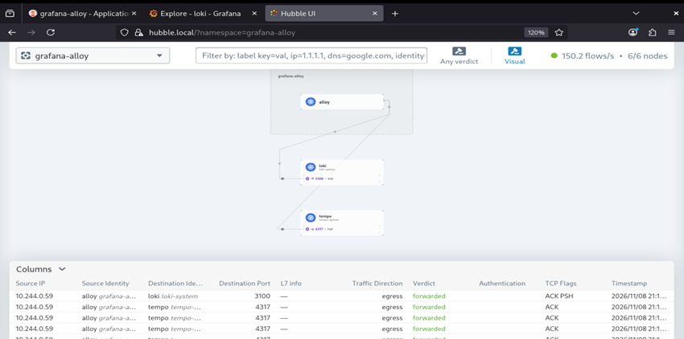

**English** | [Español](./Readme.es.md)

# Grafana Alloy - Telemetry Pipeline


Grafana Alloy wrapper chart as a unified telemetry collector: pod logs and Talos system logs to Loki, and OTLP traces to Tempo. No `hostPath` mounts, Talos Linux compatible.

## Pipeline

| Source | Input | Destination |
|--------|-------|-------------|
| Pod logs | Kubernetes API (`loki.source.kubernetes`) | Loki |
| Talos system logs | TCP `192.168.141.52:5140` (`json_lines`, `otelcol.receiver.tcplog`) | Loki |
| App traces | OTLP gRPC `:4317` / HTTP `:4318` | Tempo |
| App OTLP logs | OTLP gRPC `:4317` / HTTP `:4318` | Loki |

Pod log labels: `namespace`, `pod`, `container`, `app`, `node`, `cluster`. Talos log labels: `job="talos-system"`, `service`, `level`, `node`, `cluster`.

| Destination | Endpoint |
|-------------|----------|
| Loki | `http://loki.loki-system.svc.cluster.local:3100/loki/api/v1/push` |
| Tempo | `tempo.tempo-system.svc.cluster.local:4317` (no TLS) |

## Components

| Component | Detail |
|-----------|--------|
| Base chart | `alloy` 1.13.0, via OCI from `oci://registry.harbor.local/helm-charts` |
| Image | `registry.harbor.local/proxy-docker/grafana/alloy` |
| Controller | `Deployment`, 1 replica on infrastructure nodes |
| Config | External ConfigMap `grafana-alloy` (`configMap.create: false`), with `helm.sh/resource-policy: keep` |
| Mounts | `varlog` and `dockercontainers` disabled (no hostPath) |
| RBAC | Read-only ClusterRole on nodes, pods, pods/log, services, endpoints |
| Resources | 50m / 128Mi requests, 300m / 256Mi limits |

## Templates

| File | Detail |
|------|--------|
| `templates/configmap.yaml` | Alloy config (`config.alloy`) with the full pipeline |
| `templates/service.yaml` | `ClusterIP` Service `grafana-alloy` (OTLP `4317`/`4318`, UI `12345`) + `LoadBalancer` `grafana-alloy-talos-logs` at `192.168.141.52:5140` (`syslog-pool` pool) |
| `templates/https.yaml` | `HTTPRoute` for `alloy.local` (UI) via `infra-gateway`, plus HTTP → HTTPS redirect |

## Deployment Order

### 1. Prerequisites
- Loki (`loki-system`) and Tempo (`tempo-system`) deployed
- Gateway API and `infra-gateway` deployed
- `alloy` 1.13.0 chart pushed to Harbor

### 2. Install/Upgrade the Release
The release must be named `grafana-alloy`: the Service selector uses `app.kubernetes.io/instance: grafana-alloy`.

```bash
cd infrastructure-applications/grafana-alloy/
helm dependency update
helm upgrade --install grafana-alloy . -n grafana-alloy --create-namespace
```

### 3. Ship Talos system logs
Apply `customs/logging.yml` (destination `tcp://192.168.141.52:5140/`, format `json_lines`) to every node and add `extraTags: {node: <hostname>}` to each one so it can be identified in Loki. `otelcol.receiver.tcplog` is experimental: it requires `alloy.alloy.stabilityLevel: experimental` in `values.yaml`.

## Readiness State

After the deployment you will have:
- Logs from **every pod** in Loki
- **Talos system** logs in Loki (`job="talos-system"`)
- **OTLP** endpoint for traces and logs from instrumented apps
- Alloy UI at `alloy.local`

## Verification

```bash
kubectl get pods -n grafana-alloy -o wide
```

```bash
kubectl logs -n grafana-alloy deploy/grafana-alloy --tail 20
```

```bash
kubectl get httproute -n grafana-alloy
```

In Grafana → Explore → Loki: `{cluster="test-cluster"}`.



## Next Step

Deploy OTel Demo (`../otel-demo/`) to generate test traces and logs.

## Dependencies

- **Loki** (`../loki/`) and **Tempo** (`../tempo/`) as destinations
- **Gateway API** (`../gateway-api/`) for the route
