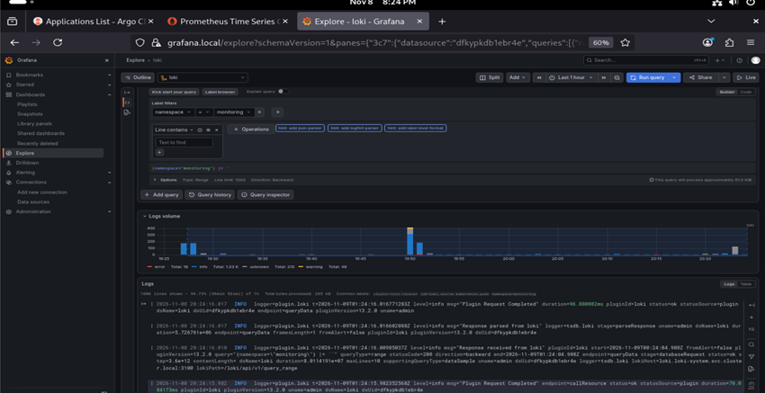
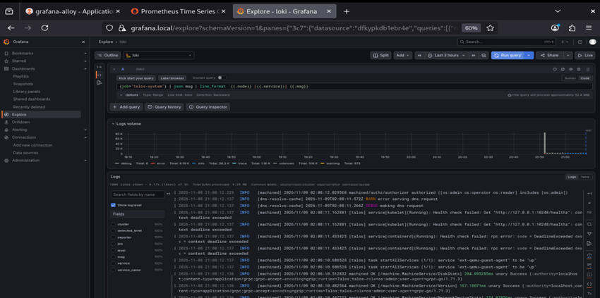

**English** | [Español](./Readme.es.md)

# Loki - Log Aggregation


Grafana Loki wrapper chart in **SingleBinary** mode with filesystem storage (Longhorn), for cluster log aggregation in a lab environment.

## Components

| Component | Detail |
|-----------|--------|
| Base chart | `loki` 18.13.4, via OCI from `oci://registry.harbor.local/helm-charts` |
| Image | `registry.harbor.local/proxy-docker/grafana/loki` |
| Mode | `SingleBinary`, 1 replica (read/write/backend at 0) |
| Storage | `filesystem` on a 2Gi PVC (`loki-longhorn`) |
| Schema | `tsdb` v13, 24h index period |
| Retention | `4h`, enforced by the compactor |
| Ingestion | 16 MB/s (burst 32), 10000 streams, lines up to 256kb |
| Auth | Disabled (`auth_enabled: false`, single tenant) |
| ServiceMonitor | Enabled for Prometheus scraping |

### Disabled components

| Component | Reason |
|-----------|--------|
| `chunksCache` / `resultsCache` | Not needed for a lab SingleBinary |
| `gateway` | Exposed directly via HTTPRoute |
| `selfMonitoring`, `lokiCanary`, `test` | Lower resource usage |

### Scheduling

- `nodeSelector`: `workload-type: infrastructure` + `node.talos.dev/tier: infrastructure`
- Toleration `workload-type=infrastructure:PreferNoSchedule`

## Deployment Order

### 1. Prerequisites
- Longhorn and the `loki-longhorn` StorageClass created
- Prometheus Stack deployed (`ServiceMonitor` CRD)
- `loki` 18.13.4 chart pushed to Harbor

### 2. Install/Upgrade the Release
```bash
cd infrastructure-applications/loki/
helm dependency update
helm upgrade --install loki . -n loki-system --create-namespace
```

## Readiness State

After the deployment you will have:
- **Loki** receiving logs on port `3100`
- Automatic 4h retention
- Loki metrics available in Prometheus

## Verification

```bash
kubectl get pods -n loki-system -l app.kubernetes.io/name=loki
```

```bash
kubectl get pvc -n loki-system | grep loki
```

```bash
kubectl port-forward -n loki-system svc/loki 3100:3100
```

```bash
curl -s http://localhost:3100/ready
```




## Next Step

Deploy Grafana Alloy (`../grafana-alloy/`) to ship node and pod logs to Loki.

## Dependencies

- **Longhorn** (`../longhorn/`) for the PVC
- **Prometheus Stack** (`../prometheus-stack/`) for the ServiceMonitor and Grafana
