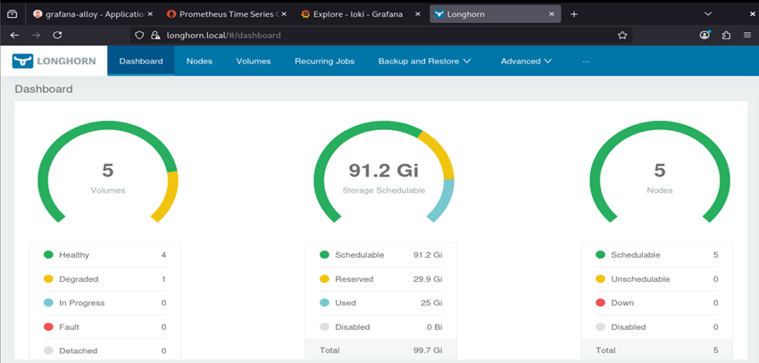

# Longhorn - Distributed Storage


Wrapper chart de Longhorn como storage de bloques distribuido del cluster, usando un disco dedicado (`/dev/sdb`) en cada nodo Talos.

## Componentes

| Componente | Detalle |
|------------|---------|
| Chart base | `longhorn` 1.12.1, vía OCI desde `oci://registry.harbor.local/helm-charts` |
| Data path | `/var/mnt/sdb-storage` (volumen Talos `sdb-storage`) |
| Espacio mínimo libre | 2% (`storageMinimalAvailablePercentage`) |
| Over-provisioning | 100% (`storageOverProvisioningPercentage`) |
| Pre-upgrade checker | Deshabilitado (`preUpgradeChecker.jobEnabled: false`) |
| UI | Service `ClusterIP` `longhorn-frontend`, expuesto vía Gateway API |

### Disco en Talos

El patch `../../talos-linux/talos-cluster-configs/customs/storage.yml` define un `UserVolumeConfig` llamado `sdb-storage` sobre `/dev/sdb` (xfs, 18–32GB). Talos lo monta en `/var/mnt/sdb-storage`, que es el `defaultDataPath` de Longhorn.

### Extensions requeridas

El installer de Talos incluye `iscsi-tools` y `util-linux-tools` (ver `../../talos-linux/talos-extensions/`), necesarias para Longhorn.

### Scheduling

El bloque `global` (nodeSelector/tolerations de infraestructura) está comentado en `values.yaml`: Longhorn corre en todos los nodos.

## Templates

| Archivo | Detalle |
|---------|---------|
| `templates/https.yaml` | `HTTPRoute` de `longhorn.local` → `longhorn-frontend:80` vía `infra-gateway`, más redirect HTTP → HTTPS |

## Orden de Despliegue

### 1. Requisitos previos
- Nodos Talos con el patch `storage.yml` y el installer con extensions
- Gateway API e `infra-gateway` desplegados
- Chart `longhorn` 1.12.1 subido a Harbor

### 2. Instalar/Actualizar el Release
```bash
cd infrastructure-applications/longhorn/
helm dependency update
helm upgrade --install longhorn . -n longhorn-system --create-namespace
```

## Estado de Preparación

Al completar el despliegue tendrás:
- **Longhorn** gestionando el disco `sdb` de cada nodo
- StorageClass `longhorn` disponible para PVCs
- UI en `longhorn.local`

## Verificación

```bash
kubectl get pods -n longhorn-system
```

```bash
kubectl get nodes.longhorn.io -n longhorn-system
```

```bash
kubectl get storageclass
```



## Siguiente Paso

Aplicar las StorageClasses custom de [`storage-classes/`](./storage-classes/Readme.md) (`prometheus-longhorn`, `grafana-longhorn`, `loki-longhorn`, `tempo-longhorn`) usadas por el stack de observabilidad.

## Dependencias

- **Talos** con `storage.yml` y extensions (`../../talos-linux/`)
- **Gateway API** (`../gateway-api/`) para la route
