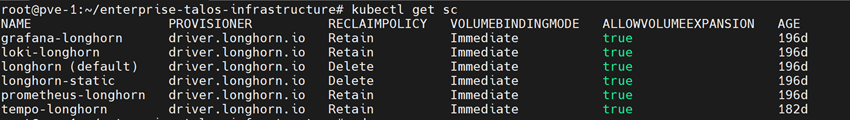

# Storage Classes - Observabilidad


StorageClasses de Longhorn dedicadas al stack de observabilidad, con réplicas solo en nodos de infraestructura.

## Recursos

| Archivo | StorageClass | Usada por |
|---------|--------------|-----------|
| `prometheus-storageclass.yaml` | `prometheus-longhorn` | Prometheus (`../../prometheus-stack/`) |
| `grafana-storageclass.yaml` | `grafana-longhorn` | Grafana (`../../prometheus-stack/`) |
| `loki-storageclass.yaml` | `loki-longhorn` | Loki (`../../loki/`) |
| `tempo-storageclass.yaml` | `tempo-longhorn` | Tempo (`../../tempo/`) |

## Parámetros comunes

| Parámetro | Valor | Detalle |
|-----------|-------|---------|
| `numberOfReplicas` | `2` | Réplicas de cada volumen |
| `nodeSelector` | `infrastructure` | Réplicas solo en nodos Longhorn con tag `infrastructure` |
| `dataLocality` | `best-effort` | Intenta mantener una réplica en el nodo del pod |
| `fsType` | `ext4` | |
| `reclaimPolicy` | `Retain` | El volumen no se borra al eliminar el PVC |
| `allowVolumeExpansion` | `true` | |

`tempo-longhorn` además asocia los volúmenes al grupo de recurring jobs `prometheus-monitoring` (en `loki-longhorn` está comentado).

## Tags de nodos en Longhorn

El `nodeSelector: "infrastructure"` de las StorageClasses se refiere a tags de nodo en Longhorn (no labels de Kubernetes):

| Nodo | Tag |
|------|-----|
| `talos-infrastructure-dt-01` | `infrastructure` |
| `talos-infrastructure-dt-02` | `infrastructure` |
| `talos-infrastructure-dt-03` | `infrastructure` |
| `talos-application-dt-01` / `02` | — |

Asignar el tag (o vía UI → Node → Edit node → Node Tags):

```bash
for n in 01 02 03; do kubectl -n longhorn-system patch nodes.longhorn.io talos-infrastructure-dt-$n --type merge -p '{"spec":{"tags":["infrastructure"]}}'; done
```

Verificar:

```bash
kubectl -n longhorn-system get nodes.longhorn.io -o custom-columns=NAME:.metadata.name,TAGS:.spec.tags
```

## Despliegue

```bash
kubectl apply -f infrastructure-applications/longhorn/storage-classes/
```

## Verificación

```bash
kubectl get storageclass
```



## Dependencias

- Longhorn desplegado (`../`)
- Nodos de infraestructura con tag `infrastructure` en Longhorn (UI → Node → Edit node → Node Tags)
- Recurring job group `prometheus-monitoring` creado en Longhorn, para `tempo-longhorn`
- Con `reclaimPolicy: Retain`, los PV liberados se borran a mano
