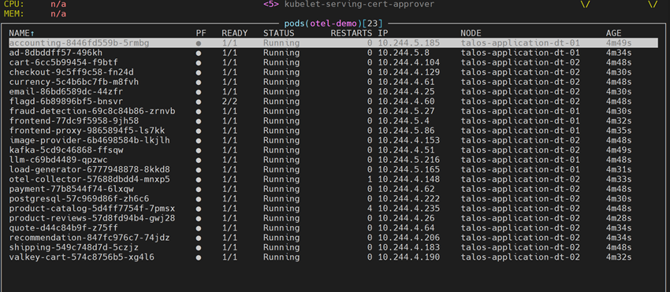
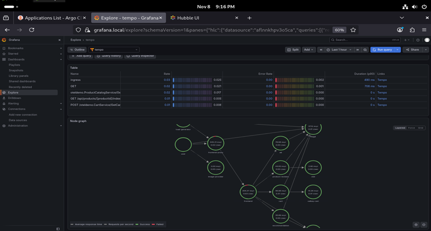

**English** | [Español](./Readme.es.md)

# OTel Demo - Astronomy Shop


OpenTelemetry Demo (Astronomy Shop) wrapper chart: a microservices shop instrumented with OpenTelemetry, used to validate the observability stack (Alloy → Tempo / Loki / Prometheus) with real traffic.

## Components

| Component | Detail |
|-----------|--------|
| Base chart | `opentelemetry-demo` 0.40.7, via OCI from `oci://registry.harbor.local/helm-charts` |
| Microservices | Astronomy Shop on **application** nodes (`default.schedulingRules`) |
| Collector | OpenTelemetry Collector in `deployment` mode, on application nodes |
| Frontend | `frontend-proxy` as `ClusterIP` |

### Disabled components

The demo ships its own observability stack; it is disabled in favour of the cluster's:

| Component | Replaced by |
|-----------|-------------|
| `jaeger` | Tempo (`../tempo/`) |
| `prometheus` | Prometheus Stack (`../prometheus-stack/`) |
| `grafana` | Prometheus Stack Grafana |
| `opensearch` | Loki (`../loki/`) |

The collector presets are also disabled (`hostMetrics`, `kubeletMetrics`, `kubernetesAttributes`, `clusterMetrics`).

### Collector pipelines

Everything is sent via OTLP to Grafana Alloy (`grafana-alloy.grafana-alloy.svc.cluster.local:4317`):

| Pipeline | Receivers | Exporters |
|----------|-----------|-----------|
| `traces` | `otlp` | `otlp/alloy`, `debug`, `spanmetrics` |
| `metrics` | `spanmetrics` (with exemplars) | `otlp/alloy` |
| `logs` | `otlp` | `otlp/alloy` |

### Scheduling

- `nodeSelector`: `workload-type: application` + `node.talos.dev/tier: application`
- Toleration `workload-type=application:PreferNoSchedule`

## Deployment Order

### 1. Prerequisites
- Grafana Alloy, Tempo, Loki and Prometheus Stack deployed
- Application workers available
- `opentelemetry-demo` 0.40.7 chart pushed to Harbor

### 2. Install/Upgrade the Release
```bash
cd infrastructure-applications/otel-demo/
helm dependency update
helm upgrade --install otel-demo . -n otel-demo --create-namespace
```

## Readiness State

After the deployment you will have:
- **Astronomy Shop** generating traffic with the load generator
- **Traces** in Tempo and **logs** in Loki, queryable from Grafana
- Service graphs and span metrics (generated by Tempo) in Prometheus

## Verification

```bash
kubectl get pods -n otel-demo -o wide
```

```bash
kubectl port-forward -n otel-demo svc/frontend-proxy 8080:8080
```

Open `http://localhost:8080`. In Grafana → Explore → Tempo, search traces for the `frontend` service.




## Dependencies

- **Grafana Alloy** (`../grafana-alloy/`) as OTLP receiver
- **Tempo**, **Loki** and **Prometheus Stack** as backends
