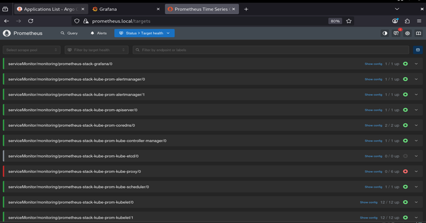

# Prometheus Stack (kube-prometheus-stack)


Wrapper chart de `kube-prometheus-stack` con Prometheus, Grafana y Alertmanager, desplegados en los nodos de infraestructura y expuestos vía Gateway API.

## Componentes

| Componente | Detalle |
|------------|---------|
| Chart base | `kube-prometheus-stack` 92.3.0, vía OCI desde `oci://registry.harbor.local/helm-charts` |
| Prometheus | Retención `4h`, PVC 2Gi (`prometheus-longhorn`), `enableRemoteWriteReceiver: true` |
| Grafana | PVC 2Gi (`grafana-longhorn`), sidecar de datasources (label `grafana_datasource: "1"`), apps Drilldown habilitadas |
| Alertmanager | Retención `4h`, PVC 1Gi (`longhorn`) |
| Prometheus Operator | Nodos de infraestructura |
| kube-state-metrics | Nodos de infraestructura |
| Node Exporter | DaemonSet en **todos** los nodos (`tolerations: Exists`) |

### Scheduling

Todos los componentes (excepto Node Exporter) usan:
- `nodeSelector`: `workload-type: infrastructure` + `node.talos.dev/tier: infrastructure`
- Toleration `workload-type=infrastructure:PreferNoSchedule`

### Remote Write

`enableRemoteWriteReceiver` habilita el endpoint `/api/v1/write` para que Grafana Alloy y Tempo (metrics generator) envíen métricas a Prometheus.

### Datasources

El sidecar de Grafana carga automáticamente los `ConfigMap` con label `grafana_datasource: "1"` (Loki y Tempo).

## Templates

| Archivo | Detalle |
|---------|---------|
| `templates/https.yaml` | `HTTPRoute` vía `infra-gateway` (sección `https`) + redirect HTTP → HTTPS (sección `http`) |

| Host | Service | Puerto |
|------|---------|--------|
| `grafana.local` | `prometheus-stack-grafana` | 80 |
| `prometheus.local` | `prometheus-stack-kube-prom-prometheus` | 9090 |
| `alertmanager.local` | `prometheus-stack-kube-prom-alertmanager` | 9093 |

## Orden de Despliegue

### 1. Requisitos previos
- Longhorn y las StorageClasses `prometheus-longhorn` / `grafana-longhorn` creadas
- Gateway API e `infra-gateway` desplegados
- Chart `kube-prometheus-stack` 92.3.0 subido a Harbor

### 2. Instalar/Actualizar el Release
El nombre del release debe ser `prometheus-stack` (los Services de las routes dependen de él).

```bash
cd infrastructure-applications/prometheus-stack/
helm dependency update
helm upgrade --install prometheus-stack . -n monitoring --create-namespace --set kube-prometheus-stack.grafana.adminPassword=TU_PASSWORD
```

## Estado de Preparación

Al completar el despliegue tendrás:
- **Prometheus** recolectando métricas del cluster y recibiendo remote write
- **Grafana** en `grafana.local` con datasources de Loki y Tempo
- **Alertmanager** en `alertmanager.local`
- **Node Exporter** en todos los nodos

## Verificación

```bash
kubectl get pods -n monitoring -o wide
```

```bash
kubectl get pvc -n monitoring
```

```bash
kubectl get httproute -n monitoring
```



## Siguiente Paso

Desplegar Loki y Tempo (`../loki/`, `../tempo/`) y luego Grafana Alloy (`../grafana-alloy/`) para completar el stack de observabilidad.

## Dependencias

- **Longhorn** (`../longhorn/`) y StorageClasses custom para los PVCs
- **Gateway API** (`../gateway-api/`) para las routes
- `adminPassword` de Grafana es un placeholder (`CHANGE_ME`): pasarlo con `--set` al instalar
