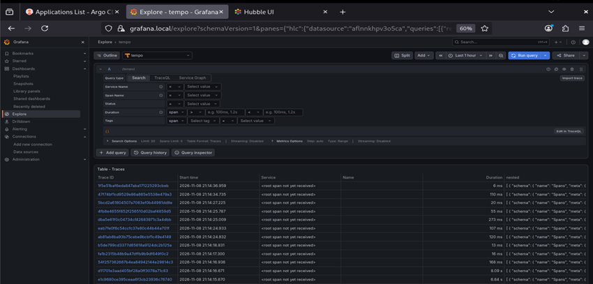
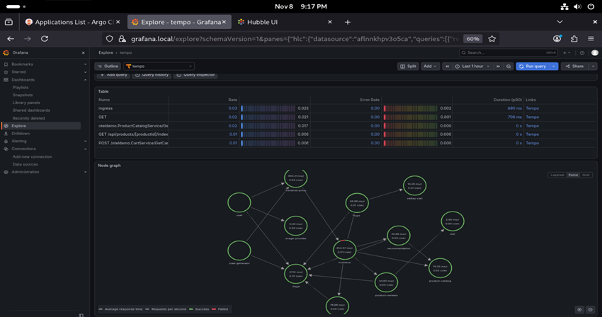

**English** | [Español](./Readme.es.md)

# Tempo - Distributed Tracing


Grafana Tempo wrapper chart in monolithic mode, the cluster's tracing backend. It receives OTLP traces from Grafana Alloy and generates metrics (service graphs, span metrics) that it sends to Prometheus via remote write.

## Components

| Component | Detail |
|-----------|--------|
| Base chart | `grafana-community/tempo` 2.0.0, via OCI from `oci://registry.harbor.local/helm-charts` |
| Image | `grafana/tempo:2.10.1` |
| Replicas | 1 (monolithic) |
| Storage | `local` backend on a 4Gi PVC (`tempo-longhorn`) |
| Retention | `168h` (7 days) |
| Receivers | OTLP gRPC `:4317` / HTTP `:4318`, Jaeger thrift_http `:14268` / gRPC `:14250` |
| API | `:3200` (queried by Grafana) |
| ServiceMonitor | Enabled (`release: prometheus-stack`) |

### Metrics Generator

| Processor | Dimensions |
|-----------|------------|
| `service-graphs` | `k8s.namespace.name`, `k8s.deployment.name` |
| `span-metrics` | `k8s.namespace.name`, `k8s.deployment.name`, `service.name` |
| `local-blocks` | `filter_server_spans: false` (TraceQL metrics) |

Remote write: `http://prometheus-stack-kube-prom-prometheus.monitoring.svc.cluster.local:9090/api/v1/write` (requires `enableRemoteWriteReceiver` in Prometheus). Limit of 100000 active series.

### Values structure

The chart uses double nesting:

```yaml
tempo:          # dependency → subchart top-level (replicas, persistence, ...)
  tempo:        # subchart's .Values.tempo.* (image, receivers, storage, ...)
```

### Scheduling

- `nodeSelector`: `workload-type: infrastructure` + `node.talos.dev/tier: infrastructure`
- Toleration `workload-type=infrastructure:PreferNoSchedule`

## Deployment Order

### 1. Prerequisites
- Longhorn and the `tempo-longhorn` StorageClass created
- Prometheus Stack with `enableRemoteWriteReceiver: true`
- `tempo` 2.0.0 chart pushed to Harbor

### 2. Install/Upgrade the Release
The release and namespace must match the endpoint used by Alloy (`tempo.tempo-system.svc`).

```bash
cd infrastructure-applications/tempo/
helm dependency update
helm upgrade --install tempo . -n tempo-system --create-namespace
```

## Readiness State

After the deployment you will have:
- **Tempo** receiving OTLP and Jaeger traces
- **Service graphs** and **span metrics** in Prometheus
- Traces queryable from Grafana (Tempo datasource, port `3200`)

## Verification

```bash
kubectl get pods,pvc -n tempo-system
```

```bash
kubectl port-forward -n tempo-system svc/tempo 3200:3200
```

```bash
curl -s http://localhost:3200/ready
```




## Next Step

Deploy Grafana Alloy (`../grafana-alloy/`) to send traces to Tempo.

## Dependencies

- **Longhorn** (`../longhorn/`) for the PVC
- **Prometheus Stack** (`../prometheus-stack/`) for remote write and ServiceMonitor
