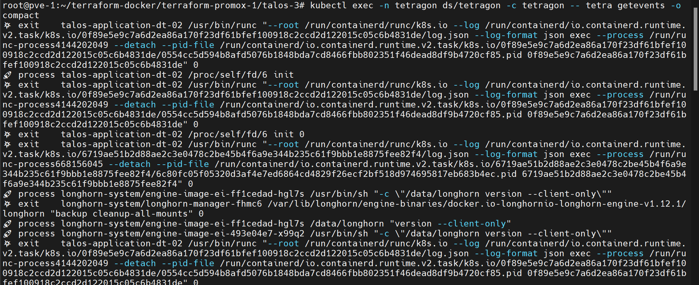

# Tetragon - eBPF Security Enforcement


Wrapper chart de Tetragon para observabilidad de seguridad y enforcement en runtime basado en eBPF (procesos, syscalls, red y archivos) en todos los nodos del cluster.

## Componentes

| Componente | Detalle |
|------------|---------|
| Chart base | `tetragon` 1.7.1, vía OCI desde `oci://registry.harbor.local/helm-charts` |
| Agente | DaemonSet en **todos** los nodos (`tolerations: Exists`), imagen `registry.harbor.local/proxy-ghcr/cilium/tetragon` |
| Operator | Imagen `registry.harbor.local/proxy-ghcr/cilium/tetragon-operator`, nodos de infraestructura |
| Export | Archivo JSON deshabilitado (`exportFilename: ""`) |
| Métricas | Agente en `:2112`, ServiceMonitor habilitado |

### Recursos

| Componente | Requests | Limits |
|------------|----------|--------|
| Agente | 100m / 128Mi | 500m / 512Mi |
| Operator | 50m / 64Mi | 200m / 256Mi |

## Orden de Despliegue

### 1. Requisitos previos
- Prometheus Stack desplegado (CRD `ServiceMonitor`)
- Chart `tetragon` 1.7.1 subido a Harbor

### 2. Instalar/Actualizar el Release
```bash
cd infrastructure-applications/tetragon/
helm dependency update
helm upgrade --install tetragon . -n tetragon
```

## Estado de Preparación

Al completar el despliegue tendrás:
- **Tetragon** observando eventos de seguridad en todos los nodos
- **TracingPolicy** CRDs disponibles para definir políticas
- Métricas en Prometheus

## Verificación

```bash
kubectl get ds,deploy -n tetragon | grep tetragon
```

```bash
kubectl get crd | grep cilium.io | grep -i tracingpolic
```

```bash
kubectl logs -n tetragon ds/tetragon -c export-stdout --tail 5
```



## Dependencias

- **Prometheus Stack** (`../prometheus-stack/`) para los ServiceMonitors
