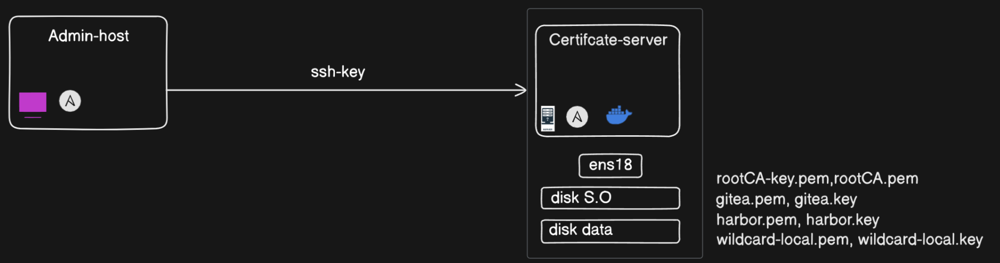
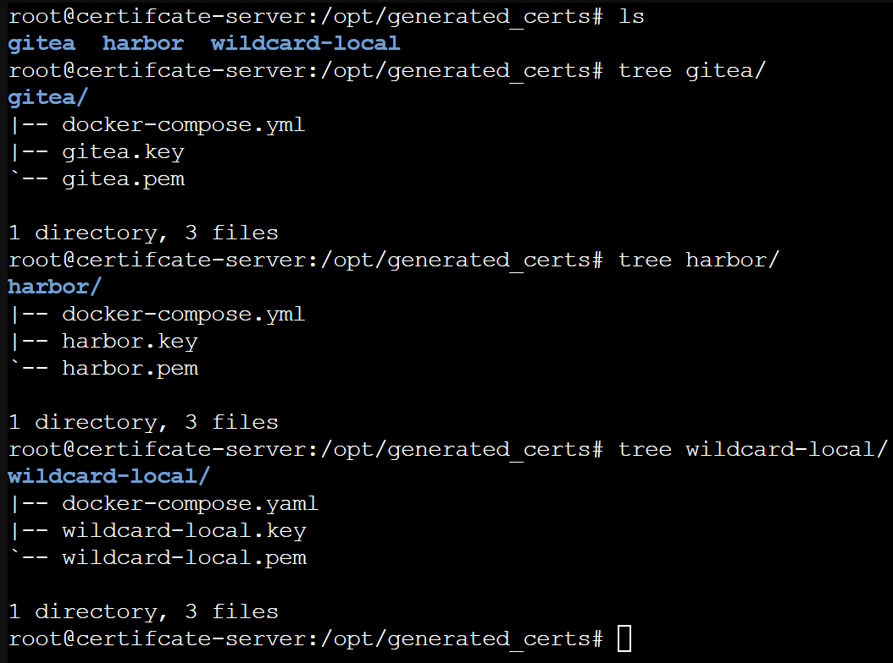

**English** | [Español](./Readme.es.md)

# Ansible mkcert Certificate Generator


Ansible role that automates SSL certificate generation with mkcert for Gitea, Harbor and wildcard domains.

## Architecture 





## Features

- **Gitea certificates**: `gitea.server.local`, local IPs
- **Harbor certificates**: `registry.harbor.local`, `harbor.server.local`, IPs
- **Wildcard certificates**: `*.local` for multiple services
- **Shared CA**: Uses the same Certificate Authority as Harbor

## Project Structure

```
mkcert-ca/
├── inventory                     # Host inventory
├── mkcer.yml                    # Main playbook
└── mkcert-ca/                   # Ansible role
    ├── defaults/main.yml        # Default variables
    ├── tasks/main.yml          # Main tasks
    └── files/                  # Docker compose files
        ├── gitea-compose.yml
        ├── harbor-compose.yml
        └── wildcard-local-compose.yml
```

## Requirements

- Ansible installed on the control machine
- Linux target host (Debian/Ubuntu recommended)
- Docker and Docker Compose on the target host
- Docker image `iamluc/mkcert:latest` available
- Harbor CA at `/opt/harbor/mkcert-ca` on the target host

## Usage

### 1. Configure the inventory

Edit the `inventory` file with your target Linux host:

```ini
[certificate_servers]
linux-server ansible_host=192.168.1.100 ansible_user=root
```

### 2. Prepare the target host

```bash
# On the target Linux host, make sure the Docker image is present
docker pull iamluc/mkcert:latest
```

### 3. Run the playbook

```bash
# Run from the mkcert-ca/ directory
ansible-playbook -i inventory mkcert-ca/mkcer.yml
```

### 4. Verify the certificates




Certificates are generated in:
- `/opt/generated_certs/gitea/` (gitea.pem, gitea.key)
- `/opt/generated_certs/harbor/` (harbor.pem, harbor.key)
- `/opt/generated_certs/wildcard-local/` (wildcard-local.pem, wildcard-local.key)

Shared CA files:
- `/opt/harbor/mkcert-ca/rootCA.pem` (CA root certificate)
- `/opt/harbor/mkcert-ca/rootCA-key.pem` (CA private key)

## Variables

Define them in `defaults/main.yml` or at runtime:

```yaml
cert_base_dir: "/opt/generated_certs"  # Base certificate directory
```

## Supported Domains

- **Gitea**: `gitea.server.local`, `localhost`, `127.0.0.1`
- **Harbor**: `registry.harbor.local`, `harbor.server.local`, `localhost`
- **Wildcard**: `*.local`, `local`, `localhost`
