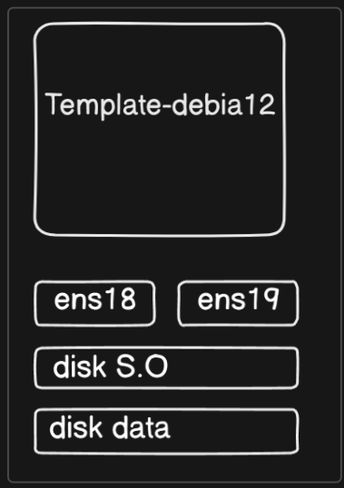

**English** | [Español](./Readme.es.md)

# Proxmox Debian 12 Template


Debian template configuration for Proxmox with LVM Docker volumes and automatic resizing.

## Architecture



## Workflow

```
CREATION: Debian VM → LVM Config → Proxmox Template
USAGE: Template → New VM → Auto-resize at boot

LVM LAYOUT:
/dev/sdb → PV → VG (vg_data) → LV (docker_data) → /var/lib/docker/volumes
```

## Features

- **Auto-resize**: Expands automatically at boot
- **Zero Config**: VMs ready for Docker immediately  
- **Scalable**: Works with any disk size
- **Compatible**: Terraform, Ansible, etc.

## Requirements

- Clean Debian VM on Proxmox
- Additional disk (`/dev/sdb`)
- Root permissions

## Creating the VM on Proxmox

### VM Configuration
```bash
# Proxmox UI: Datacenter → Node → Create VM

VM ID: 100
Name: debian-docker-template
ISO: Debian 12 (Bookworm)
Type: Linux 6.x - 2.6 Kernel

# System
SCSI Controller: VirtIO SCSI single
Qemu Agent:  ENABLE

# Disks
SCSI 0: 20GB (System)
SCSI 1: 10GB (Docker LVM)
Cache: Write back
Discard:  Enable

# Hardware  
CPU: 2 cores, type host
RAM: 2048 MB
Network: VirtIO, bridge vmbr0
```

### Debian Installation
- Install Debian 12 with a graphical interface
- Configure SSH and the root user
- Check disks: `lsblk` (sda=system, sdb=docker)

## LVM Configuration

### Quick Method (Scripts)
```bash
# Run the 4 scripts in order:
./01-install-packages.sh
./02-lvm-setup.sh  
./03-create-resize-script.sh
./04-setup-autostart.sh
```

### Manual Method

#### 1. Install packages
```bash
apt update
apt install lvm2 -y
apt install -y qemu-guest-agent
```

#### 2. Configure LVM
```bash
pvcreate /dev/sdb
vgcreate vg_data /dev/sdb  
lvcreate -n docker_data -l 100%FREE vg_data
mkfs.ext4 /dev/vg_data/docker_data
mkdir -p /var/lib/docker/volumes
mount /dev/vg_data/docker_data /var/lib/docker/volumes
echo "/dev/vg_data/docker_data /var/lib/docker/volumes ext4 defaults 0 2" >> /etc/fstab
```

#### 3. Auto-resize script
```bash
cat > /usr/local/bin/resize-docker-volumes.sh << 'EOF'
#!/bin/bash
pvresize /dev/sdb
lvextend -l +100%FREE /dev/vg_data/docker_data
resize2fs /dev/vg_data/docker_data
EOF

chmod +x /usr/local/bin/resize-docker-volumes.sh
```

#### 4. Configure automatic startup
```bash
cat > /etc/rc.local << 'EOF'
#!/bin/sh -e
sleep 60
cd /usr/local/bin && ./resize-docker-volumes.sh
exit 0
EOF

chmod +x /etc/rc.local
systemctl start rc-local.service
```


## Verification

```bash
# Check LVM
pvdisplay && vgdisplay && lvdisplay

# Check mount
df -h | grep docker

# Check service
systemctl status rc-local.service

# On a new VM (check auto-resize)
lsblk
df -h /var/lib/docker/volumes
```
