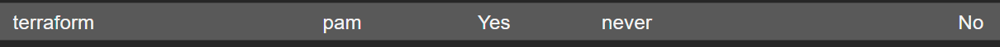
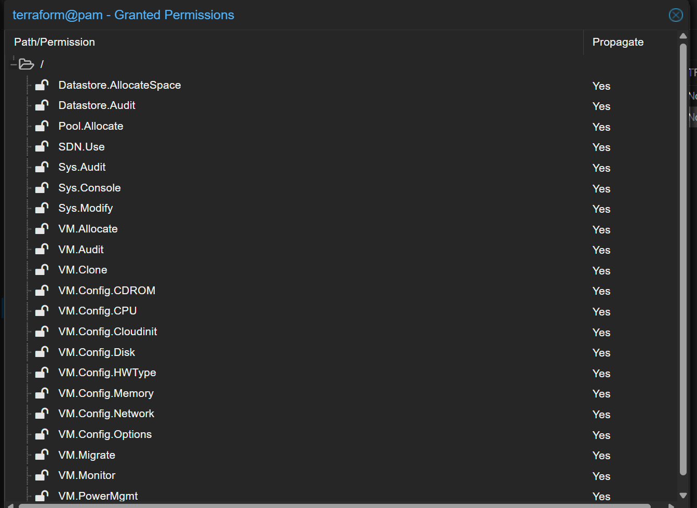
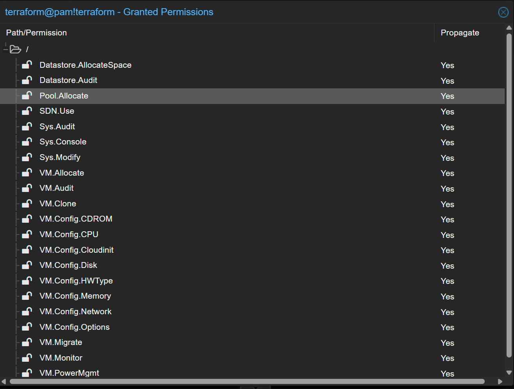

**English** | [Español](./Readme.es.md)

# Proxmox User and Token for Terraform


Commands to create a user and API token in Proxmox for Terraform automation with the BPG provider.

## 1. Create the User

```bash
# Create the terraform user in the PAM realm
pveum user add terraform@pam

```

## 2. Create a Role with Permissions

```bash
# Create the TerraformProv role with every required permission
pveum role add TerraformProv --privs "Datastore.AllocateSpace,Datastore.Audit,Pool.Allocate,SDN.Use,Sys.Audit,Sys.Console,Sys.Modify,VM.Allocate,VM.Audit,VM.Clone,VM.Config.CDROM,VM.Config.CPU,VM.Config.Cloudinit,VM.Config.Disk,VM.Config.HWType,VM.Config.Memory,VM.Config.Network,VM.Config.Options,VM.Migrate,VM.Monitor,VM.PowerMgmt"
```

## 3. Assign the Role to the User

```bash
# Assign the role at the root path with propagation
pveum acl modify / --roles TerraformProv --users terraform@pam --propagate
```

## 4. Create the API Token

```bash
# Create a token that inherits the user's permissions
pveum user token add terraform@pam terraform --privsep 0 --comment "Terraform automation token"
```

**Expected result:**
```
┌──────────────┬──────────────────────────────────────┐
│ key          │ value                                │
├──────────────┼──────────────────────────────────────┤
│ full-tokenid │ terraform@pam!terraform              │
├──────────────┼──────────────────────────────────────┤
│ value        │ xxxxxxxx-xxxx-xxxx-xxxx-xxxxxxxxxxxx │
└──────────────┴──────────────────────────────────────┘
```

## 5. Use the Token in Terraform

### Understanding the API Token

The generated token has **two parts**:
- **Token ID**: `terraform@pam!terraform` (identifier)  
- **Token Secret**: `xxxxxxxx-xxxx-xxxx-xxxx-xxxxxxxxxxxx` (secret value)

**For the BPG provider**: they are joined with `=` → `terraform@pam!terraform=xxxxxxxx-xxxx-xxxx-xxxx-xxxxxxxxxxxx`

### Provider Configuration

```hcl
terraform {
  required_providers {
    proxmox = {
      source  = "bpg/proxmox"
      version = "~> 0.80.0"
    }
  }
}

provider "proxmox" {
  endpoint = "https://192.168.1.100:8006/"
  api_token = "terraform@pam!terraform=xxxxxxxx-xxxx-xxxx-xxxx-xxxxxxxxxxxx"
  insecure = true  # If you use self-signed certificates
}
```

### Environment Variables (Recommended)

```bash
# Set environment variables
export PM_API_URL="https://192.168.1.100:8006/api2/json"
export PM_API_TOKEN_ID="terraform@pam!terraform"
export PM_API_TOKEN_SECRET="xxxxxxxx-xxxx-xxxx-xxxx-xxxxxxxxxxxx"
```

```hcl
terraform {
  required_providers {
    proxmox = {
      source  = "bpg/proxmox"
      version = "~> 0.80.0"
    }
  }
}

provider "proxmox" {
  # Environment variables are picked up automatically
  insecure = true  # If you use self-signed certificates
}
```

## Verify the Configuration

```bash
# Show user permissions
pveum user permissions terraform@pam

# Show token permissions
pveum user token permissions terraform@pam terraform

# List tokens
pveum user token list terraform@pam
```
You can also verify it from the Proxmox web UI

User verification 


User permissions verification


Token permissions verification


## Connection Data

- **API URL**: `https://your-proxmox-ip:8006/api2/json`
- **Token ID**: `terraform@pam!terraform`
- **Token Secret**: The value generated in step 4
- **Insecure**: `true` (if you use self-signed certificates)
