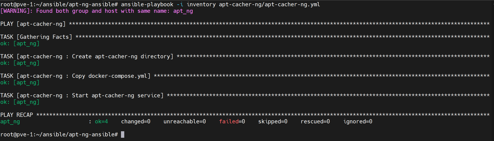
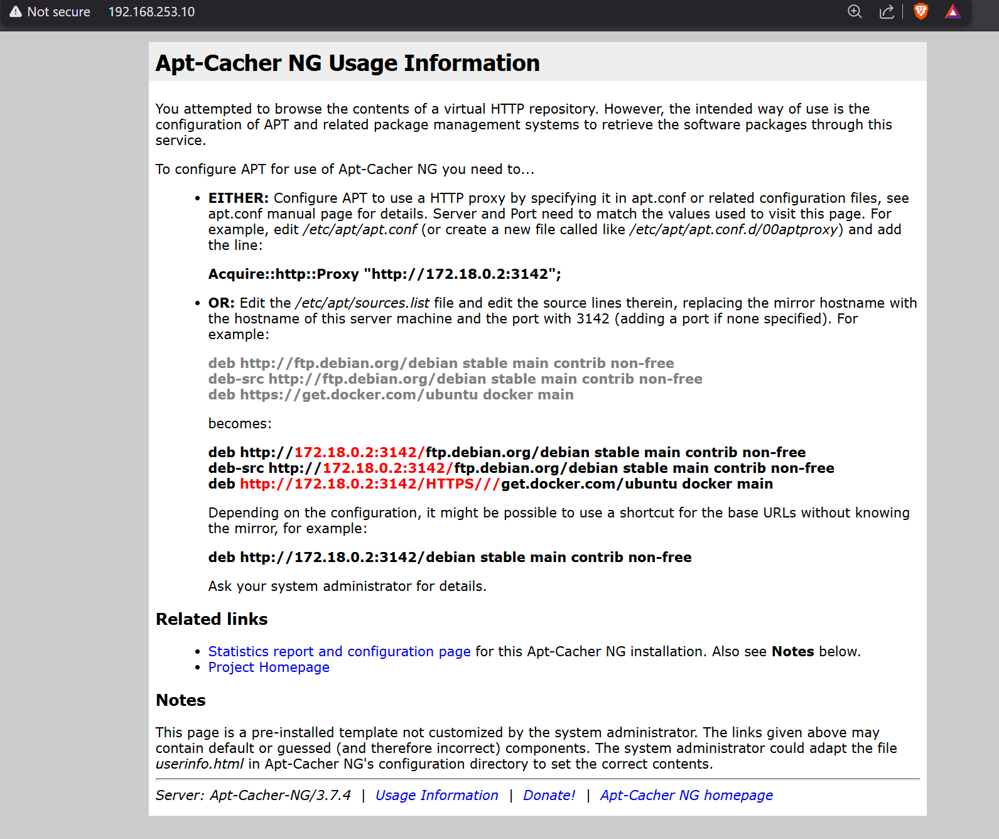

**English** | [Español](./Readme.es.md)

# APT-Cacher-NG Service


Automated cache proxy for APT/Debian packages using Ansible and Docker Compose.

## What is it?

APT-Cacher-NG caches APT packages locally. Clients download a package from the internet once; subsequent installations are served instantly from the local cache.

### Main Benefits

- **Bandwidth savings**: Packages are downloaded from the internet only once
- **Faster installs**: Subsequent installations from the local cache are instant
- **Reduced load**: Fewer requests to official repositories
- **Offline availability**: Works even when external repositories are unreachable
- **Network efficiency**: Ideal for environments with many Debian/Ubuntu servers

## Prerequisites

- Docker and Docker Compose
- Ansible 2.9+
- Internet access

## Installation

```bash
# Run playbook
ansible-playbook -i inventory apt-cacher-ng.yml
```



## Configuration

### Variables

```yaml
# defaults/main.yml
apt_cacher_ng_port: 3142
apt_cacher_ng_directory: /opt/apt-cacher-ng
```

### Inventory

```ini
[apt_cache_servers]
cache-server ansible_host=192.168.1.50 ansible_user=root
```

## Usage

### Configure an Ubuntu/Debian Client

```bash
# Permanent configuration
echo 'Acquire::http::Proxy "http://CACHE_IP:3142";' | sudo tee /etc/apt/apt.conf.d/01proxy

# Use the cache
apt update
apt install nginx
```

### Web Panel

```
http://CACHE_IP:3142/acng-report.html
```


## Verification

```bash
# Service status
docker ps | grep apt-cacher-ng

# Logs
docker logs apt-cacher-ng

# Test from a client
curl http://CACHE_IP:3142/acng-report.html
```

## Administration

```bash
# Restart
cd /opt/apt-cacher-ng && docker compose restart

# Show cache usage
docker exec apt-cacher-ng du -sh /var/cache/apt-cacher-ng
```
