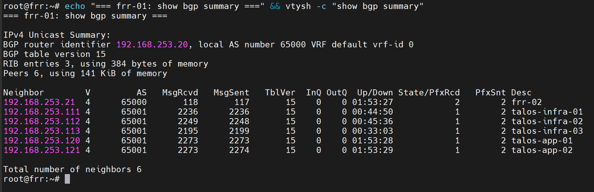
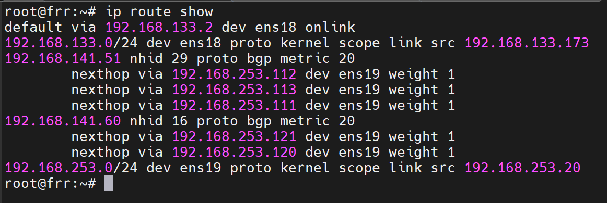

**English** | [Español](./Readme.es.md)

# FRR - BGP Router (Cilium Peering)


Two FRR routers (`frr-01`/`frr-02`) acting as intermediate BGP peers between the Cilium BGP Control Plane (AS 65001) and the homelab network, in AS 65000. Provisioned with Terraform and configured with Ansible.

## Components

| Component | Detail |
|-----------|--------|
| VMs | `frr-01` (192.168.253.20), `frr-02` (192.168.253.21) — cloned from template 8002 (Debian 13) |
| Terraform | `terraform/code/vm-frr.tf`, `frr_nodes` variable in `terraform/code/variables.tf` |
| Ansible | `frr-ansible/` — `frr-install` role, one static `frr.conf` per node in `frr-install/files/` |
| Local ASN | 65000 (iBGP peer between frr-01 and frr-02) |
| Remote ASN | 65001 (Cilium nodes, see `../../infrastructure-applications/cilium/bgp/`) |

## Deployment Order

### 1. Provision the VMs (Terraform)
```bash
cd terraform/
docker compose run --rm terraform apply -target='proxmox_virtual_environment_vm.frr["frr-01"]' -target='proxmox_virtual_environment_vm.frr["frr-02"]'
```

### 2. Copy the admin SSH key to each VM
```bash
ssh-copy-id root@192.168.253.20
ssh-copy-id root@192.168.253.21
```

### 3. Install and configure FRR (Ansible)
```bash
cd frr-ansible/
ansible-playbook -i inventory frr-install.yml
```

## Readiness State

After the deployment you will have:
- **FRR** installed and running on both nodes, with `bgpd` enabled
- **iBGP** established between `frr-01` ↔ `frr-02`
- **eBGP** ready to peer with the Cilium nodes (AS 65001) once `../../infrastructure-applications/cilium/` is deployed

## Verification

```bash
vtysh -c "show bgp summary"
```

It must show the iBGP peer (`.20`/`.21` with each other) and the peers towards the Talos nodes in `Established` state once Cilium is deployed.




## Next Step

With FRR running, deploy `../../infrastructure-applications/cilium/` so the Talos nodes start peering via BGP and LoadBalancer IPs are advertised correctly.

## Dependencies

- Template 8002 (Debian 13) available on Proxmox
- `bpg/proxmox` provider configured (`terraform/provider.tf`)
- Requires internet access for the FRRouting repo (`deb.frrouting.org`), or a local mirror via apt-cacher-ng
