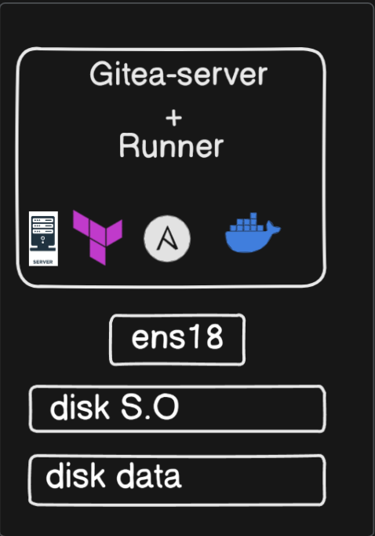

**English** | [Español](./Readme.es.md)

# Gitea Enterprise Suite


Complete automation suite to deploy and manage an enterprise Gitea infrastructure with air-gapped support. Includes the server, runners and local actions.

## General Architecture


## Suite Components

### 1. Gitea Install ([gitea-install-ansible/](./gitea-install-ansible/))
**Gitea server with reverse proxy and TLS certificates**

```
Functions:
- Gitea 1.24.2 server with Docker Compose
- Traefik reverse proxy with SSL/TLS
- Harbor Registry integration
- Automatic configuration for Actions

Result: https://gitea.server.local (with TLS certificates)
```

### 2. Gitea Runners ([gitea-runners-ansible/](./gitea-runners-ansible/))  
**CI/CD runners with Docker-in-Docker support**

```
Functions:
- Automated runner deployment
- Docker-in-Docker configuration
- Connectivity with the Harbor registry
- Strict SSL and corporate certificates

Result: Runners registered and ready for pipelines
```

### 3. Gitea Actions ([gitea-actions-ansible/](./gitea-actions-ansible/))
**GitHub Actions for air-gapped environments**

```
Functions:
- Pre-download of 25+ GitHub Actions
- Deployment as local repositories
- Full air-gapped support
- Automatic organization in Gitea

Result: Local actions at https://192.168.253.11/actions/
```

## Full Deployment Flow

### Base Infrastructure (Prerequisites)
```bash
# Run in order (prerequisites for the whole suite):
ansible-playbook host-network-1ip.yml
ansible-playbook docker-install.yml  
ansible-playbook ansible-proxy.yaml
ansible-playbook certificados.yml
```

### Gitea Suite Deployment
```bash
# 1. Install the Gitea server
cd gitea-install-ansible/
ansible-playbook -i inventory gitea-install.yml

# 2. Configure runners  
cd ../gitea-runners-ansible/
ansible-playbook -i inventory gitea-runner.yml

# 3. Deploy actions (air-gapped)
cd ../gitea-actions-ansible/
./git.sh  # Run from a server with internet
scp /tmp/github-actions-airgap-full-repos.tar.gz root@192.168.253.11:/opt/
ansible-playbook -i inventory gitea-actions.yml
```

## Network Configuration

### Services and Ports
```
Gitea Server:
- Web: https://gitea.server.local (443)
- SSH: git@gitea.server.local:2222
- API: https://gitea.server.local/api/v1/

Harbor Registry:  
- Registry: registry.harbor.local (443)
- Web: https://harbor.local (443)

Traefik:
- Dashboard: http://gitea.server.local:8080
```

### Hosts Configuration
```bash
# Add to /etc/hosts on every node:
192.168.253.11    gitea.server.local
192.168.253.12    registry.harbor.local harbor.local
```

## Full Pipeline Example

### CI/CD Pipeline using Local Actions
```yaml
# .gitea/workflows/ci.yml
name: Enterprise CI Pipeline
on: [push]

jobs:
  build:
    runs-on: gitea-runner-docker
    steps:
      # Use local actions (air-gapped)
      - uses: https://192.168.253.11/actions/checkout@v4
      
      - uses: https://192.168.253.11/actions/setup-node@v4
        with:
          node-version: '18'
          
      # Build with the Harbor registry
      - uses: https://192.168.253.11/actions/docker-build-push-action@v6
        with:
          push: true
          tags: registry.harbor.local/project/app:${{ github.sha }}
          
      - uses: https://192.168.253.11/actions/upload-artifact@v4
        with:
          name: build-artifacts  
          path: dist/
```

## Enterprise Features

### Security
- **TLS certificates**: Full integration with the corporate PKI
- **Air-gapped support**: Operation without internet after the setup
- **Private registry**: Docker images from the local Harbor
- **SSH security**: Git operations over SSH on a dedicated port

### High Availability  
- **Health checks**: Automated service monitoring
- **Persistent storage**: Persistent Docker volumes
- **Auto recovery**: Container restart policies
- **Load balancing**: Traefik as reverse proxy

### DevOps Integration
- **Docker-in-Docker**: Full support for containerized pipelines  
- **25+ Actions**: Complete library of local GitHub Actions
- **API first**: Integration via the Gitea REST API
- **Webhook support**: Integration with external systems

## Repository Structure
```
gitea-server/
├── gitea-install-ansible/     # Gitea server + Traefik
│   ├── files/
│   │   ├── docker-compose.yml
│   │   ├── tls.yml  
│   │   └── certificados/
│   └── tasks/main.yml
├── gitea-runners-ansible/     # CI/CD runners
│   ├── files/
│   │   ├── docker-compose.yml
│   │   └── config.yaml
│   └── tasks/main.yml  
└── gitea-actions-ansible/     # Air-gapped actions
    ├── files/
    │   └── github-actions-airgap-full-repos.tar.gz
    ├── tasks/
    │   ├── main.yml
    │   └── push.yml
    └── vars/main.yml
```
