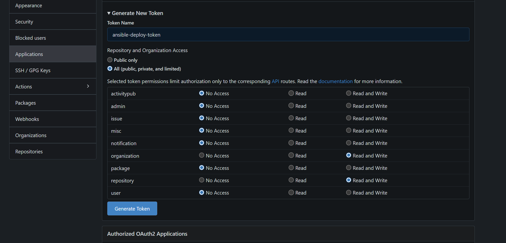
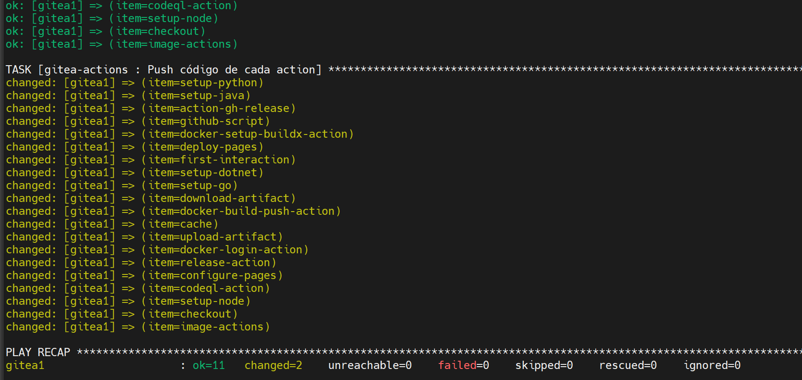
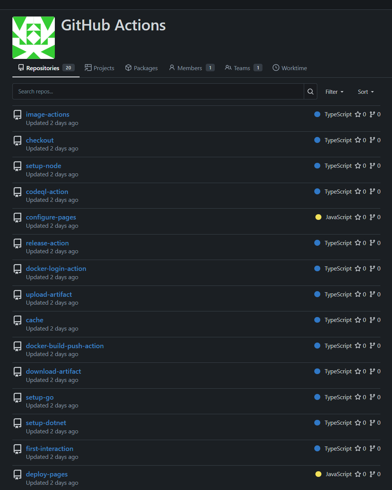

**English** | [Español](./Readme.es.md)

# Gitea Actions Air-Gapped Deployment


Automated solution to deploy GitHub Actions in air-gapped environments using Gitea and Ansible. Designed for infrastructures without internet access where actions must live locally.

## The Problem
In air-gapped environments, `uses: actions/checkout@v4` fails because it cannot reach GitHub.com. This solution pre-downloads the actions and deploys them as local repositories in Gitea.

## Project Structure
```
gitea-actions/
├── vars/main.yml              # Main variables
├── files/github-actions-airgap-full-repos.tar.gz
├── tasks/main.yml             # Extraction and setup
├── tasks/push.yml             # Push to Gitea
└── gitea-actions.yml          # Main playbook
```

## Architecture
```
Internet → GitHub Repos → tar.gz → Air-Gapped Server → Gitea Local Repos
Pipeline: uses: https://192.168.253.11/actions/checkout@v4
```

## Features
- **25+ GitHub Actions** pre-downloaded (checkout, setup-node, docker-build, etc.)
- **Optional selective deployment** for specific actions
- **Zero internet dependency** after the initial setup
- **Full Git history** with tags for complete compatibility

## Initial Setup

### 1. Gitea Token
Generate an admin token at: `https://192.168.253.11/user/settings/applications`
- Scopes: `repo`, `admin:org`, `admin:repo_hook`

### 2. Variables (vars/main.yml)
```yaml
---
gitea_url: "https://192.168.253.11"
gitea_admin_password: "YOUR_ADMIN_TOKEN_HERE"
gitea_actions_org: "actions"

# Optional: selective deployment
# selected_actions:
#   - checkout
#   - setup-node
#   - upload-artifact
```



## Deployment

### Full Method
```bash
# 1. Download actions (server with internet)
./git.sh

# 2. Transfer to the air-gapped server
scp /tmp/github-actions-airgap-full-repos.tar.gz root@192.168.253.11:/opt/

# 3. Run ansible
ansible-playbook -i inventory gitea-actions.yml
```


### Verification
```bash
# Check the organization
curl -k https://192.168.253.11/api/v1/orgs/actions \
  -H "Authorization: token YOUR_TOKEN"

# Browse the actions on the web
https://192.168.253.11/actions
```




## Usage in Pipelines

### Required Change
```yaml
# DOES NOT WORK (requires internet)
- uses: actions/checkout@v4

# CORRECT (local repository)
- uses: https://192.168.253.11/actions/checkout@v4
```

### Example Pipeline
```yaml
name: Air-Gapped CI
on: [push]
jobs:
  build:
    runs-on: gitea-runner
    steps:
      - uses: https://192.168.253.11/actions/checkout@v4
      - uses: https://192.168.253.11/actions/setup-node@v4
        with:
          node-version: '18'
      - run: npm ci && npm run build
```

## Included Actions

### Critical
- `checkout v4` - Code checkout
- `upload-artifact v4` - Upload artifacts  
- `download-artifact v4` - Download artifacts
- `cache v4` - Cache system

### Language Setup
- `setup-node v4`, `setup-python v5`, `setup-go v5`, `setup-java v4`

### Docker
- `docker-build-push-action v6`, `docker-login-action v3`

### Utilities
- `github-script v7`, `release-action v1.13.0`, `codeql-action v3`
