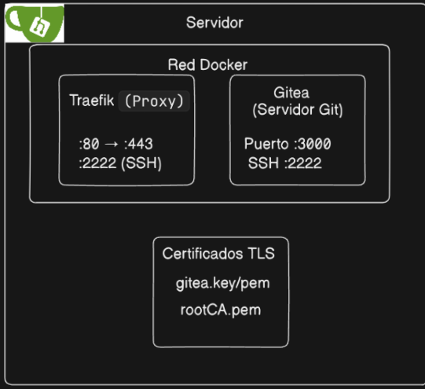
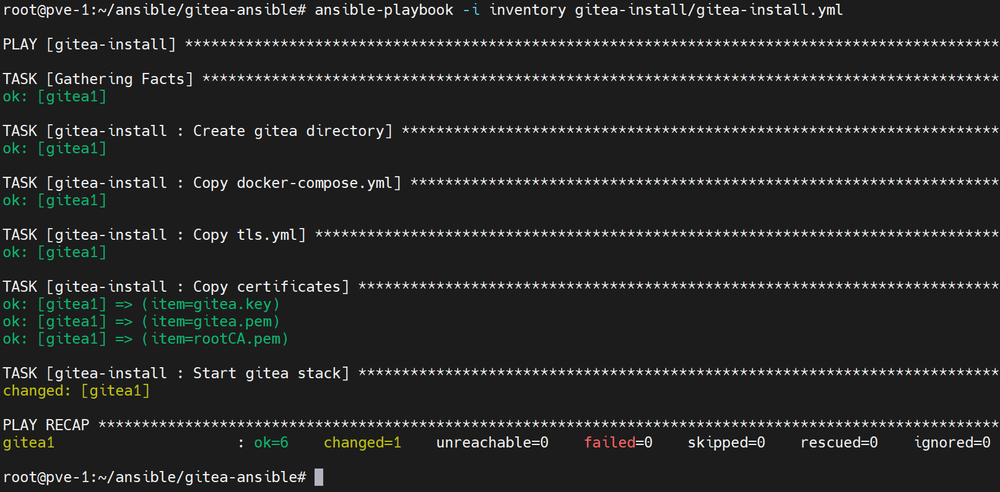
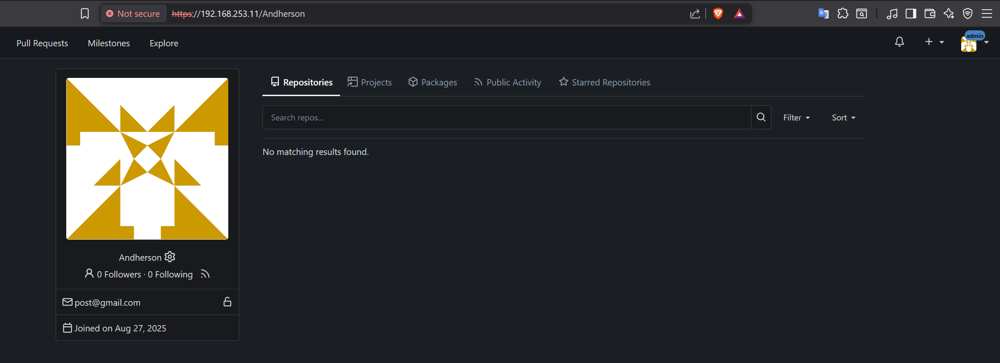

**English** | [Español](./Readme.es.md)

# Gitea Server with Ansible & Docker


Automated deployment of a Gitea server with a Traefik reverse proxy, TLS certificates and Harbor registry integration.

## Architecture



## Workflow

```
DEPLOYMENT: Admin Host (Ansible) → Gitea Server (Docker Compose) → Traefik + Gitea
ACCESS: https://gitea.server.local (Web) | SSH Port 2222
REGISTRY: Integration with the local Harbor Registry
CERTIFICATES: Custom TLS with Root CA
```

## Features

- **Zero Config**: Gitea server ready with Actions enabled
- **TLS Ready**: Custom certificates with Traefik automation  
- **SSH Support**: Git operations over SSH on port 2222
- **Harbor Integration**: Uses the local Harbor registry for images
- **Health Checks**: Built-in container monitoring
- **Auto SSL**: Automatic redirect to HTTPS

## Requirements

### Ansible Configuration (Prerequisites)
The following playbooks must run **BEFORE** this role:

- host-network-1ip.yml 
- docker-install.yml 
- ansible-proxy.yaml
- certificados.yml

### System Requirements
- **Admin Host**: Ansible control node with SSH access
- **Gitea Server**: Target server configured with the prerequisite playbooks
- Access to the Harbor registry (`registry.harbor.local`)
- TLS certificates generated (gitea.key, gitea.pem, rootCA.pem)
- DNS resolution for `gitea.server.local`


### Manual Configuration

#### 1. Prepare Certificates
```bash
# Place the certificates in the files/ directory:
cp gitea.key files/
cp gitea.pem files/  
cp rootCA.pem files/
```

#### 2. Run the Ansible Role
```bash
ansible-playbook -i inventory gitea-install/gitea-install.yml
```
Playbook


Web verification



## Directory Structure

```
gitea-install/
├── defaults/main.yml          # Default variables
├── files/                     # Static files
│   ├── docker-compose.yml     # Main stack definition
│   ├── tls.yml               # Traefik TLS configuration
│   ├── gitea.key             # TLS private key
│   ├── gitea.pem             # TLS certificate
│   └── rootCA.pem            # Root CA certificate
├── handlers/main.yml          # Ansible handlers
├── tasks/main.yml            # Main installation tasks
├── meta/main.yml             # Role metadata
└── README.md                 # This file
```

## Configuration Details

### Deployment Architecture
- **Admin Host**: Runs Ansible and manages the configuration
- **Gitea Server**: Receives the deployment and runs the containers

### Gitea Configuration
- **Domain**: gitea.server.local
- **Database**: SQLite3 (embedded)
- **Actions**: Enabled for CI/CD
- **Install Lock**: Enabled for security

### Traefik Configuration  
- **HTTP → HTTPS**: Automatic redirect
- **TLS**: Custom certificates via the file provider
- **SSH**: TCP routing for Git operations
- **Dashboard**: Available on port 8080

### Network Configuration
```yaml
Ports:
  80   → 443   (HTTP → HTTPS redirect)
  443  → 3000  (Gitea web interface)
  2222 → 2222  (Git SSH operations)

Volumes:
  gitea-data: Persistent Git repositories
  certificates: Custom TLS certificates  
```

## Usage

### Accessing Gitea
```bash
# Web interface
https://gitea.server.local

# Clone a repository over SSH  
git clone git@gitea.server.local:2222/user/repo.git

# Clone a repository over HTTPS
git clone https://gitea.server.local/user/repo.git
```

### Verification
```bash
# Check containers
docker ps | grep gitea

# Show logs
docker logs gitea-server
docker logs gitea-traefik

# Test connectivity
curl -k https://gitea.server.local
```
## Integration

### With the Harbor Registry
This role uses Harbor as the container registry source. Make sure Harbor is reachable at `registry.harbor.local`.

### With the Enterprise Infrastructure  
Part of the Talos enterprise infrastructure ecosystem. Compatible with:
- Kubernetes clusters
- Monitoring stacks  
- Backup systems
- CI/CD pipelines
