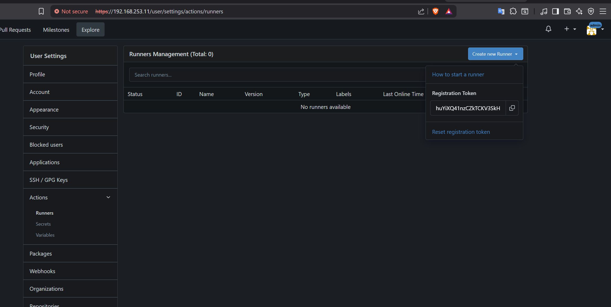
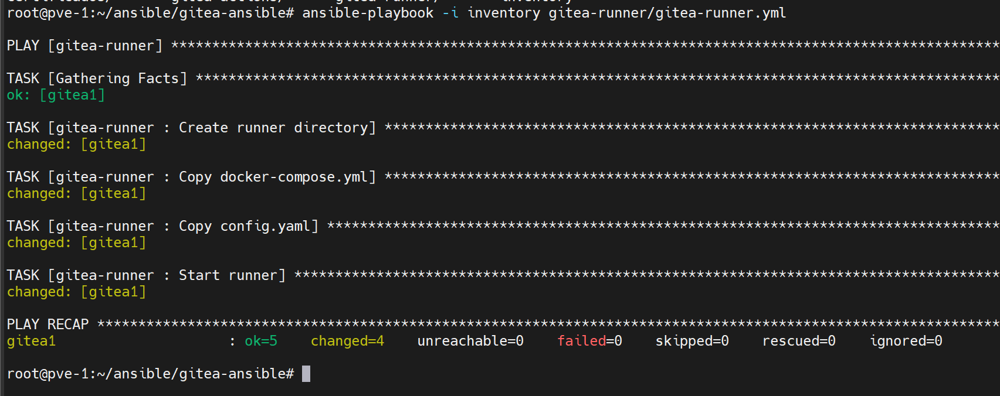
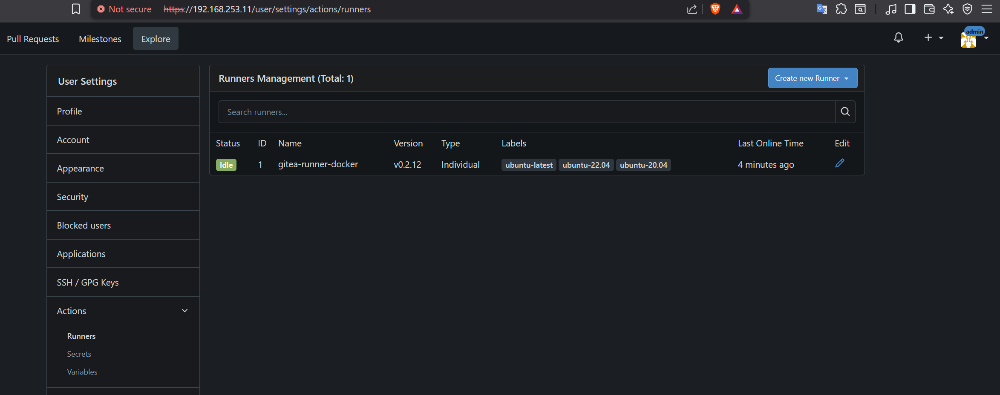

**English** | [Español](./Readme.es.md)

# Gitea Runner Ansible Deployment


Automated Gitea Runner deployment with Ansible on a multi-layer Proxmox infrastructure with a private Harbor registry.

## Workflow
```
DEPLOYMENT: Ansible Role → Docker Compose → Gitea Runner Container
CONNECTION: Runner → Gitea Server (gitea.server.local:192.168.253.11)
REGISTRY: Harbor Registry (registry.harbor.local:192.168.253.12)
EXECUTION: Runner → Docker in Docker → CI/CD Pipeline
```

## Features
- **Auto-registration**: Automatic configuration with a registration token
- **Docker-in-Docker**: Full support for container pipelines  
- **Private registry**: Integration with the local Harbor registry
- **Strict SSL**: Strict SSL/TLS certificate verification ✅
- **Force Pull**: Images refreshed automatically on every run
- **CA Certificates**: Full support for corporate certificates
- **Ansible Ready**: Fully automated deployment
- **Persistent Data**: Persistent Docker volumes
- **Custom Hosts**: Custom DNS resolution for internal services

## Requirements
- Server with Docker and Docker Compose
- Access to the Gitea Server (192.168.253.11)
- Access to the Harbor Registry (192.168.253.12)
- Ansible 2.9+ on the control machine
- Gitea registration token

## Project Structure
```
gitea-runner/
├── defaults/main.yml           # Default variables
├── files/
│   ├── config.yaml            # Runner configuration
│   └── docker-compose.yml     # Service definition
├── handlers/main.yml          # Ansible handlers
├── tasks/main.yml            # Main tasks
├── vars/main.yml             # Specific variables
└── gitea-runner.yml          # Main playbook
```

## Configuration

### Main Variables (defaults/main.yml)
```yaml
# Gitea Configuration
gitea_instance_url: "https://gitea.server.local"
gitea_runner_token: "CHANGE_ME"
gitea_runner_name: "gitea-runner-docker"

# Harbor Registry
harbor_registry_url: "registry.harbor.local"

# Network Configuration
gitea_server_ip: "192.168.253.11"
harbor_registry_ip: "192.168.253.12"
```

### Docker Compose Services
```yaml
services:
  gitea-runner:
    image: registry.harbor.local/proxy-docker/gitea/act_runner:latest
    container_name: gitea-runner
    restart: always
    environment:
      - CONFIG_FILE=/config.yaml
      - GITEA_INSTANCE_URL=https://gitea.server.local
      - GITEA_RUNNER_REGISTRATION_TOKEN={{ gitea_runner_token }}
      - GITEA_RUNNER_NAME={{ gitea_runner_name }}
      - DOCKER_HOST=unix:///var/run/docker.sock
    volumes:
      - ./config.yaml:/config.yaml:ro
      - gitea-runner-data:/data
      - /var/run/docker.sock:/var/run/docker.sock
      - /etc/ssl/certs/ca-certificates.crt:/etc/ssl/certs/ca-certificates.crt:ro
```

## Deployment

### Quick Method
```bash
# Run the full playbook
ansible-playbook -i inventory gitea-runner.yml
```

### Step-by-Step Method
#### 1. Prepare the inventory
```bash
# Create an inventory with the target hosts
cat > inventory << EOF
[gitea_runners]
runner-01 ansible_host=192.168.1.100
runner-02 ansible_host=192.168.1.101
EOF
```

#### 2. Configure variables

Replace the token with your Gitea token in the compose file

```bash
# Edit variables in defaults/main.yml
docker-compose.yaml
```



#### 3. Run the deployment
```bash
# Deploy with specific tags
ansible-playbook -i inventory gitea-runner.yml --tags "docker,runner"

# Full deployment with verbose output
ansible-playbook -i inventory gitea-runner.yml -v
```



#### 4. Verify services
```bash
# Check runner status
ansible all -i inventory -m shell -a "docker ps | grep gitea-runner"

# Check logs
ansible all -i inventory -m shell -a "docker logs gitea-runner"
```

## Runner Configuration

### Full Config.yaml
```yaml
---
log:
  level: info
runner:
  file: .runner
  capacity: 1
  timeout: 3h
  shutdown_timeout: 0s
  insecure: false
  fetch_timeout: 5s
  fetch_interval: 2s
cache:
  enabled: true
  dir: ""
  host: ""
  port: 0
container:
  options: >-
    --add-host=gitea.server.local:192.168.253.11
    --add-host=registry.harbor.local:192.168.253.12
    -v /etc/ssl/certs/ca-certificates.crt:/etc/ssl/certs/ca-certificates.crt:ro
    -e NODE_EXTRA_CA_CERTS=/etc/ssl/certs/ca-certificates.crt
    -e GIT_SSL_NO_VERIFY=false
  valid_volumes:
    - "/etc/ssl/certs/ca-certificates.crt"
  network: ""
  privileged: false
  force_pull: true
  force_rebuild: false
host:
  workdir_parent: /tmp/act_runner
```

### Advanced Configuration

#### SSL and Certificates
```yaml
container:
  options: >-
    -v /etc/ssl/certs/ca-certificates.crt:/etc/ssl/certs/ca-certificates.crt:ro
    -e NODE_EXTRA_CA_CERTS=/etc/ssl/certs/ca-certificates.crt
    -e GIT_SSL_NO_VERIFY=false
  valid_volumes:
    - "/etc/ssl/certs/ca-certificates.crt"
```

#### Custom hosts
```bash
# The runner automatically includes:
gitea.server.local:192.168.253.11       # Gitea server
registry.harbor.local:192.168.253.12    # Harbor registry
```


## Verification

```bash
# Check the container
docker ps | grep gitea-runner
docker logs gitea-runner

# Check registration in Gitea
curl -k https://gitea.server.local/api/v1/admin/runners

# Check Harbor connectivity
docker pull registry.harbor.local/proxy-docker/hello-world

# Basic pipeline test
git push origin main  # Trigger pipeline
```


