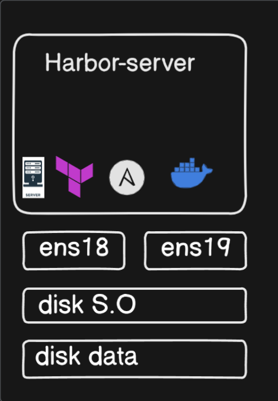
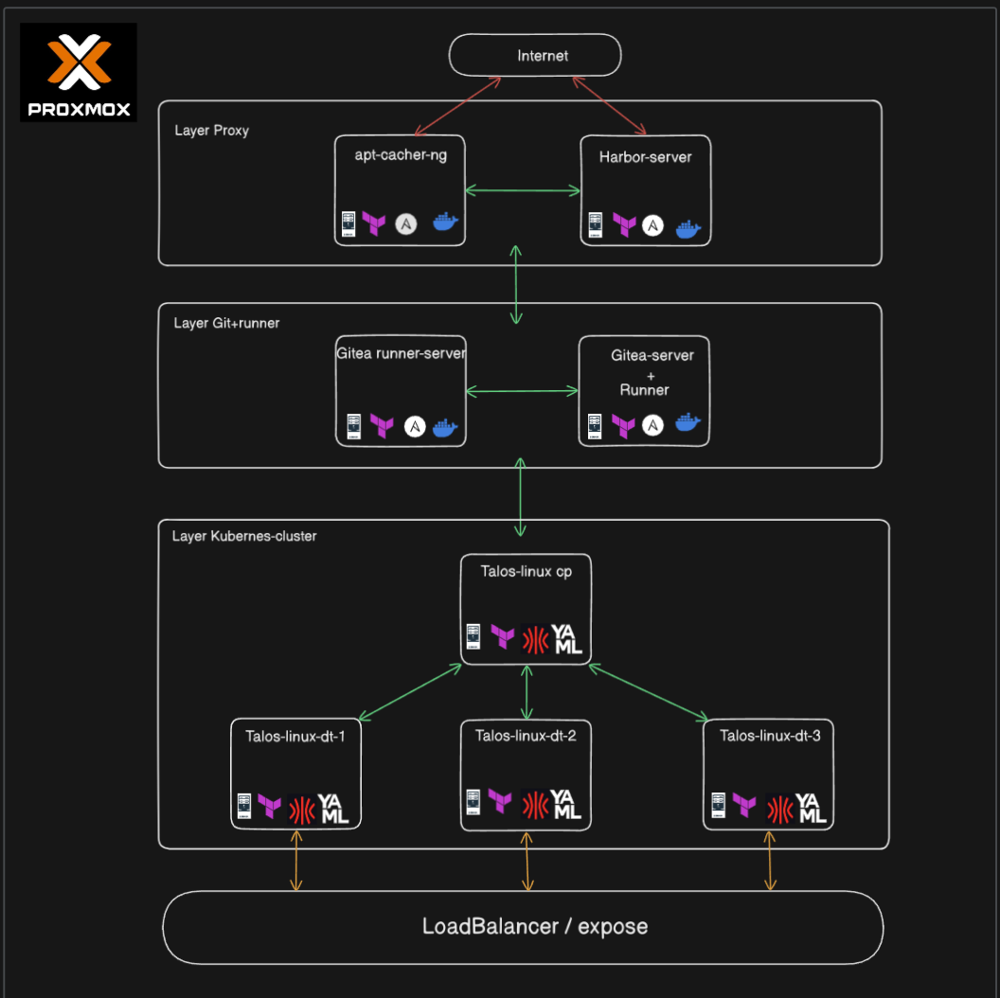
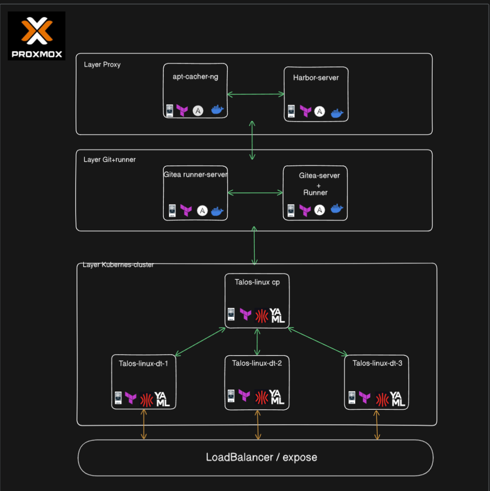

**English** | [Español](./Readme.es.md)

# Harbor Enterprise Suite


Complete automation suite to deploy and manage an enterprise Harbor infrastructure with proxy cache, security scanning and SBOM generation.

## Table of Contents

- [Quick Start](#quick-start)
- [Project Structure](#project-structure)
- [Architecture and Operating Modes](#architecture-and-operating-modes)
- [Full Implementation Process](#full-implementation-process)
- [Module Documentation](#module-documentation)

## Quick Start

**New to the Harbor Enterprise Suite?** Follow this flow:

1. **Read this introduction** (you are here)
2. **Install Harbor** → Go to [`harbor-install/README.md`](./harbor-install/Readme.md)
3. **Learn how to use it** → Go to [`harbor-use/README.md`](./harbor-use/Readme.md)

## Project Structure

```
harbor-enterprise-suite/
├── README.md                    # Main guide (you are here)
├── harbor-install/              # Installation module
│   ├── README.md                #    Full installation guide
│   ├── files/                   #    Harbor files and certificates
│   ├── tasks/main.yml           #    Ansible tasks
│   └── defaults/main.yml        #    Configuration variables
└── harbor-use/                  # Usage module
    ├── README.md                #    Full day-to-day usage guide
    └── scripts/                 #    Administration scripts
```

### Documentation by Module

| Module | Purpose | Documentation |
|--------|---------|---------------|
| **Main** | Introduction and architecture | `README.md` (this file) |
| **harbor-install** | Automated installation | [`harbor-install/README.md`](./harbor-install/Readme.md) |
| **harbor-use** | Day-to-day operations | [`harbor-use/README.md`](./harbor-use/Readme.md) |

## Architecture and Operating Modes



### Mode 1: Internet Access (Proxy Cache)

**Capabilities**:
- Active proxy cache for 4 external registries
- Automatic downloads from Docker Hub, Quay, Kubernetes and GitHub
- Automatic Trivy database updates
- Requires permanent internet access

**Use Cases**:
- Development environments with connectivity
- Bandwidth reduction and rate-limit mitigation
- Faster recurring pulls



### Mode 2: Fully Air-Gapped (No Internet)

**Capabilities**:
- Local repositories only (docker-images, helm-charts)
- Manual push of previously downloaded images
- Offline Trivy database (requires manual updates)
- Fully internal operation without external access

**Use Cases**:
- Fully isolated production environments
- High-security sectors (finance, government, defense)
- Strict compliance requirements with no external connectivity



### Mode 3: Hybrid

**Process**:
1. Initial installation with internet access
2. Proxy cache configuration and pre-population
3. Full disconnection from the internet
4. Local-only operation

## Full Implementation Process

### Phase 1: Infrastructure Preparation

Run these base playbooks in order:

```bash
ansible-playbook host-network-1ip.yml
ansible-playbook docker-install.yml  
ansible-playbook ansible-proxy.yaml
ansible-playbook certificados.yml
```

### Phase 2: Harbor Installation

**Full documentation**: [`harbor-install/README.md`](./harbor-install/Readme.md)

```bash
# 1. Go to the installation module
cd harbor-install/

# 2. Follow the detailed guide
# See: harbor-install/README.md

# 3. Run the installation
ansible-playbook -i inventory harbor-install.yml
```

### Phase 3: Configuration and Day-to-Day Use

**Full documentation**: [`harbor-use/README.md`](./harbor-use/Readme.md)

```bash
# 1. Verify the installation
curl -k https://registry.harbor.local/api/v2.0/health

# 2. Follow the day-to-day usage guide
# See: harbor-use/README.md

# 3. Configure projects and proxy cache
# See full examples in harbor-use/README.md
```

## Main Components

### Harbor Registry
Open-source private container registry originally developed by VMware, with advanced enterprise features.

### Trivy Security Scanner
Open-source vulnerability scanner providing automated CVE detection and dependency analysis.

### Software Bill of Materials (SBOM)
Detailed inventory of software components, compliant with the SPDX and CycloneDX standards.

## Network Configuration

### Services and Ports
- **Web UI**: `https://registry.harbor.local` (443)
- **Docker API**: `https://registry.harbor.local/v2/` (443)
- **Notary**: `https://registry.harbor.local:4443`

### Proxy Cache Endpoints
- **Docker Hub**: `registry.harbor.local/proxy-docker/*`
- **Quay.io**: `registry.harbor.local/proxy-quay/*`
- **Kubernetes**: `registry.harbor.local/proxy-k8s/*`
- **GitHub**: `registry.harbor.local/proxy-ghcr/*`

### Hosts Configuration
```bash
# Add to /etc/hosts on every node
192.168.253.12    registry.harbor.local harbor.local
```

## Module Documentation

### Automated Installation
**File**: [`harbor-install/README.md`](./harbor-install/Readme.md)

**Contains**:
- Full preparation and installation
- Variable configuration
- Required file structure
- Post-installation verification
- Backup and upgrade

### Day-to-Day Operations
**File**: [`harbor-use/README.md`](./harbor-use/Readme.md)

**Contains**:
- Proxy cache for 4 registries
- Project and repository management
- Security scanning with Trivy
- SBOM generation and download
- Administration scripts
- Troubleshooting

## Enterprise Features

### Security
- **Trivy integration**: Automatic vulnerability scanning
- **SBOM generation**: Full component inventory
- **CVE blocking**: Prevents deployment of vulnerable images
- **Corporate certificates**: Integration with the enterprise PKI

### Performance
- **Proxy cache**: Local cache for 4 main registries
- **Rate-limit bypass**: Avoids Docker Hub limits
- **High availability**: Persistent storage
- **API first**: Full integration via the REST API
