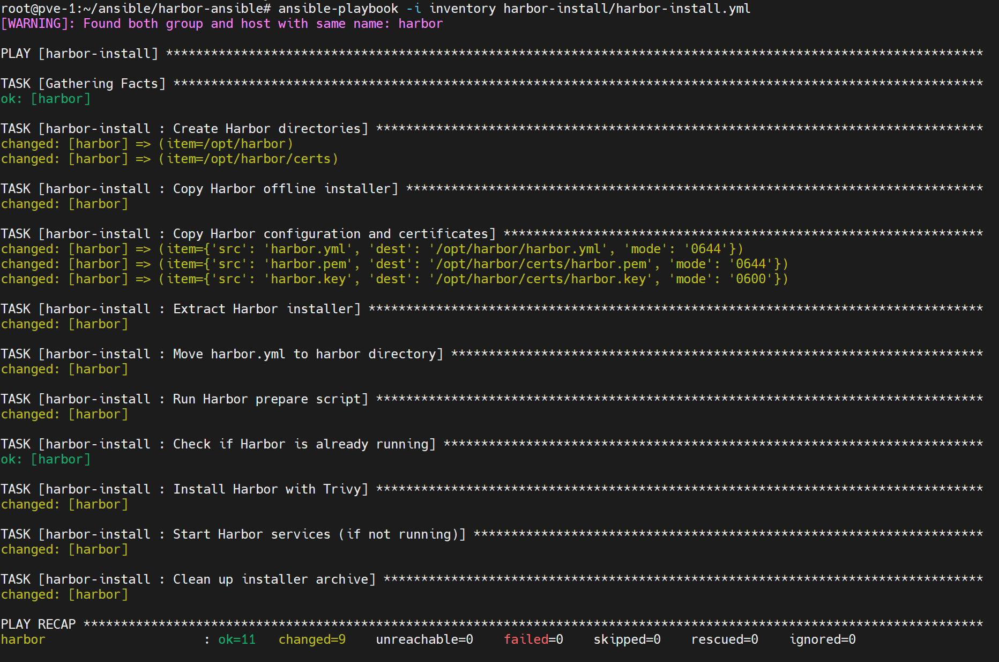
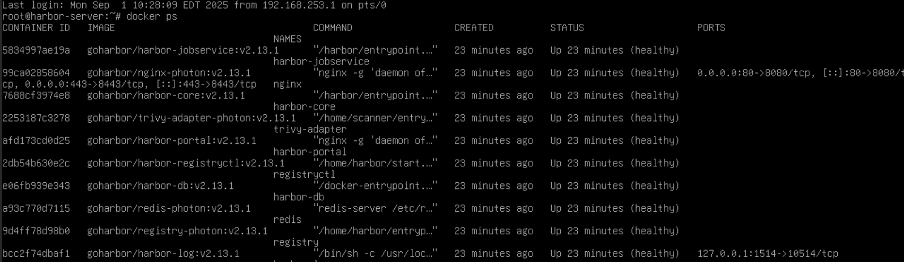
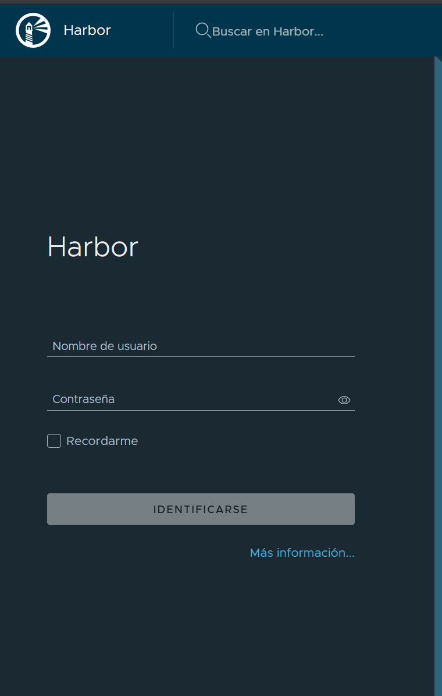

**English** | [Español](./Readme.es.md)

# Harbor Ansible Installation 


Guide for an automated Harbor installation with an Ansible playbook, including SSL certificates and the Trivy scanner.

## Features

-  **Offline installation** with Harbor v2.13.1
-  **SSL/TLS** preconfigured
-  **Trivy scanner** integrated
-  **Docker Compose** automated
-  **Idempotent** and reusable

## Preparation

### 1. Download Harbor

```bash
wget https://github.com/goharbor/harbor/releases/download/v2.13.1/harbor-offline-installer-v2.13.1.tgz
```

### 2. Project Structure

```
harbor-install/
├── files/
│   ├── harbor-offline-installer-v2.13.1.tgz  # ← Place it here
│   ├── harbor.yml                             # Configuration
│   ├── harbor.pem                             # SSL certificate
│   └── harbor.key                             # Private key
├── tasks/main.yml                             # Ansible tasks
└── defaults/main.yml                          # Variables
```

## Configuration

### Main Variables

```yaml
# defaults/main.yml
harbor_install_dir: "/opt/harbor"
harbor_hostname: "harbor.company.local"
harbor_admin_password: "Harbor12345"
harbor_ssl_enabled: true
harbor_trivy_enabled: true
```

### Inventory

```ini
[harbor_servers]
harbor-server ansible_host=192.168.1.100 ansible_user=root

[harbor_servers:vars]
harbor_hostname=registry.company.com
harbor_admin_password=MySecurePassword123
```

## Installation

### Basic Playbook

```yaml
# harbor-install.yml
---
- name: Install Harbor Registry
  hosts: harbor_servers
  become: yes
  roles:
    - harbor-install
```

### Run

```bash
# Standard installation
ansible-playbook -i inventory harbor-install.yml

# With custom variables
ansible-playbook -i inventory harbor-install.yml \
  -e "harbor_hostname=registry.company.com"
```



## Verification

### Check Status

```bash
# Running services
cd /opt/harbor/harbor && docker compose ps

# Web access
curl -k https://harbor.server.local

```




### Web Access

```
URL: https://harbor.server.local
User: admin
Password: [your harbor_admin_password]
```



### Expected Services

```
 harbor-core        (Main API)
 harbor-portal      (Web UI)
 registry           (Docker registry)
 harbor-db          (PostgreSQL)
 redis              (Cache)
 trivy-adapter      (Scanner)
```

### Ports in use

```bash
# Check ports
netstat -tlnp | grep -E ':(80|443)'

# Free the port if needed
sudo fuser -k 443/tcp
```

## Backup and Upgrade

### Create a Backup

```bash
cd /opt/harbor/harbor && docker compose down
tar -czf harbor-backup-$(date +%Y%m%d).tar.gz /opt/harbor/
```

### Upgrade Harbor

```bash
# Re-run the role with the new version
ansible-playbook -i inventory harbor-install.yml \
  -e "harbor_version=v2.14.0"
```

## SSL Certificates

### Renew Certificates

```bash
# Back up the current ones
cp /opt/harbor/certs/harbor.* /backup/

# Copy the new ones
cp new-harbor.pem /opt/harbor/certs/harbor.pem
cp new-harbor.key /opt/harbor/certs/harbor.key
chmod 600 /opt/harbor/certs/harbor.key

# Restart
cd /opt/harbor/harbor && docker compose restart
```

## Important Notes

- The `.tgz` file must be in `files/` before running
- Change default passwords in production
- Verify DNS resolution of the hostname
- Regularly back up the PostgreSQL database
