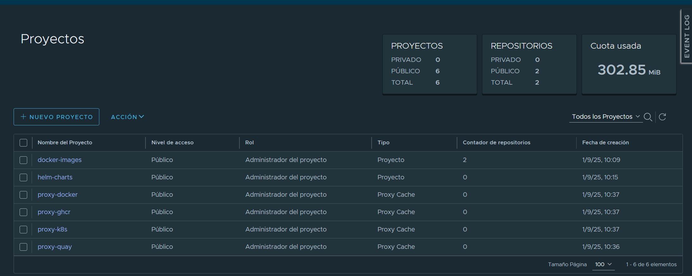
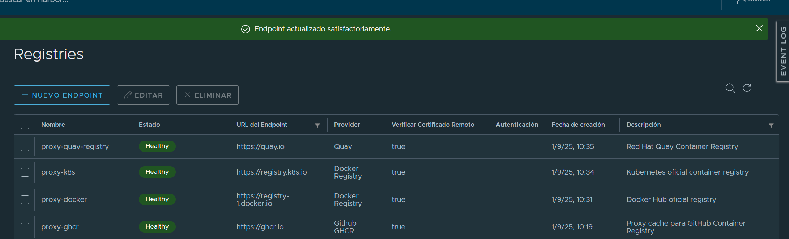
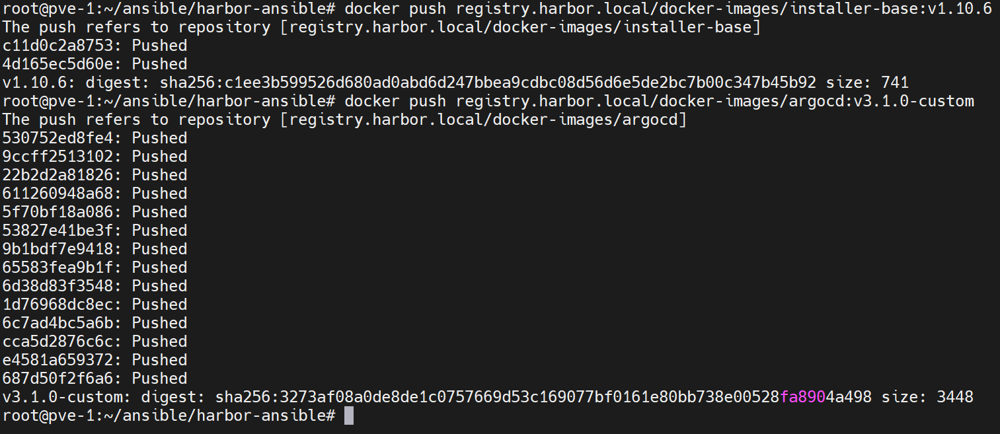
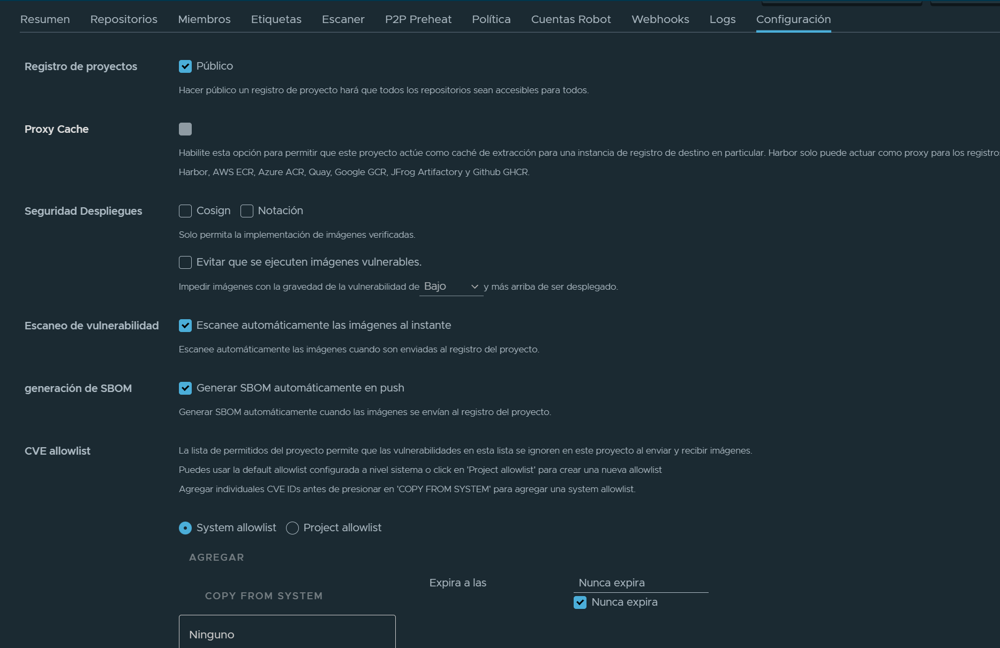

**English** | [Español](./Readme.es.md)

# Harbor Registry - Usage Guide


Day-to-day usage guide for Harbor Registry with proxy cache, security scanning and SBOM generation.

## What are Harbor, Trivy and SBOM?

### Harbor Registry
Harbor is an open-source private container registry originally developed by VMware. It acts as a central repository to store, manage and distribute Docker/OCI images. It includes advanced features such as:

- Proxy cache for multiple external registries
- Role-based access control (RBAC)
- Built-in vulnerability scanning
- Image replication between registries

### Trivy Security Scanner

Trivy is an open-source vulnerability scanner developed by Aqua Security. It integrates with Harbor to:

- Detect known vulnerabilities (CVEs) in container images
- Analyze dependencies and libraries inside the images
- Classify vulnerabilities by severity (Critical, High, Medium, Low)
- Block deployment of images with critical vulnerabilities

### SBOM (Software Bill of Materials)
An SBOM is a detailed inventory of every software component in an application or image. It includes:

- Full list of dependencies and libraries
- Exact version of each component
- Software licenses in use
- Associated vulnerability information
- Standard formats: SPDX (Linux Foundation) and CycloneDX (OWASP)

## Available Proxy Registries

```
proxy-docker   → registry-1.docker.io     (Docker Hub)
proxy-quay     → quay.io                   (Red Hat Quay)
proxy-k8s      → registry.k8s.io          (Kubernetes)
proxy-ghcr     → ghcr.io                   (GitHub Container Registry)
```

## Project Structure (Current State)

```
registry.harbor.local/
├── docker-images/        # (argocd, installer-base)
├── helm-charts/          # (ready for Helm charts)  
├── proxy-docker/         # (Docker Hub proxy cache)
├── proxy-quay/           # (Quay.io proxy cache)
├── proxy-k8s/            # (K8s proxy cache)
└── proxy-ghcr/           # (GitHub proxy cache)

```




## Using the Proxy Cache

### External Registry Status
```bash
# All configured endpoints are Healthy:
proxy-quay-registry     https://quay.io               
proxy-k8s               https://registry.k8s.io          
proxy-docker            https://registry-1.docker.io   
proxy-ghcr              https://ghcr.io                 
```



### Pull through the Proxy
```bash
# Log in to the registry
docker login registry.harbor.local -u admin

# Docker Hub through the proxy
docker pull registry.harbor.local/proxy-docker/library/nginx:latest
docker pull registry.harbor.local/proxy-docker/grafana/grafana:latest
docker pull registry.harbor.local/proxy-docker/library/redis:latest

# Kubernetes registry through the proxy  
docker pull registry.harbor.local/proxy-k8s/ingress-nginx/controller:latest
docker pull registry.harbor.local/proxy-k8s/metrics-server/metrics-server:latest

# GitHub Container Registry through the proxy
docker pull registry.harbor.local/proxy-ghcr/fluxcd/source-controller:latest
docker pull registry.harbor.local/proxy-ghcr/dexidp/dex:latest

# Quay.io through the proxy
docker pull registry.harbor.local/proxy-quay/prometheus/prometheus:latest
docker pull registry.harbor.local/proxy-quay/argoproj/argocd:latest
```



### Proxy Cache Benefits
- **Speed**: Fast downloads from the local cache
- **Bandwidth savings**: Downloads from the internet only once
- **Availability**: Works even if the external registry is down
- **Rate limiting**: Avoids Docker Hub and other registry limits

## Creating and Managing Repositories

### Create a New Project
```bash
# Via UI: Projects - New Project
Name: my-project
Access: Public/Private
Proxy Cache: No (for custom projects)
```

### Pushing Custom Images
```bash
# Real examples of successful pushes:

# 1. Installer-base (Talos Linux)
docker tag ghcr.io/siderolabs/installer-base:v1.10.6 registry.harbor.local/docker-images/installer-base:v1.10.6
docker push registry.harbor.local/docker-images/installer-base:v1.10.6
#  Pushed: digest sha256:c1ee3b599526d680ad0abd6d247bbea9cdbc08d56d6e5de2bc7b00c347b45b92 size: 741

# 2. Custom ArgoCD
docker tag argocd-custom:v3.1.0 registry.harbor.local/docker-images/argocd:v3.1.0-custom  
docker push registry.harbor.local/docker-images/argocd:v3.1.0-custom
#  Pushed: digest sha256:3273af08a0de8de1c0757669d53c169077bf0161e80bb738e00528fa8904a498 size: 3448
```

### docker-images Project Configuration
```yaml
Project registry:  Public
Proxy Cache:  Disabled (for custom images)
Deployment security:
  - Cosign:  Available  
  - Notation:  Available
  - Prevent vulnerable images:  Enabled (Severity: Low)
Vulnerability scanning:  Automatic on push
SBOM generation:  Automatic on push
CVE allowlist: System allowlist (system level)
```



### Tag Management
```bash
# Multiple tags for the same image
docker tag my-app:latest harbor.local/docker-images/my-app:latest
docker tag my-app:latest harbor.local/docker-images/my-app:stable

docker push harbor.local/docker-images/my-app:latest
docker push harbor.local/docker-images/my-app:stable
```

## Security Scanning with Trivy (Configured)

### Automatic Configuration Enabled
```yaml
Automatic scanning:  Enabled on push
Prevent vulnerable images:  Enabled  
Blocking level: Low and above
SBOM generation:  Automatic on push
CVE Allowlist: System allowlist (system level)
```

### Reading Vulnerability Results
```yaml
Severity Levels:
  Critical: Requires immediate action - BLOCKED
  High: Should be fixed soon - BLOCKED
  Medium: Review when possible - BLOCKED  
  Low: Informational - BLOCKED (configured)
  Unknown: No severity information
```

### Check Scanning in the UI
```bash
# Navigate to: Projects - docker-images - Repository - Artifact
# Available tabs:
# - Overview: General information
# - Security: Detected vulnerabilities  
# - SBOM: Generated Software Bill of Materials
# - Build History: Build history
```

## SBOM (Software Bill of Materials) - Auto-Generated

### Current Configuration
```yaml
Status:  Enabled globally
Trigger: Automatic on push
Formats: SPDX, CycloneDX  
Storage: Stored with each artifact
```

### Accessing the Generated SBOM
```bash
# Via UI: 
# Projects - docker-images - argocd - Artifacts - SBOM tab

# For installer-base:v1.10.6
# Projects - docker-images - installer-base - Artifacts - SBOM tab

# Download formats: JSON, XML
```

## Day-to-Day Management

### Harbor Restart Script
```bash
#!/bin/bash
HARBOR_PATH="/opt/harbor/harbor"
echo "Restarting Harbor..."
cd $HARBOR_PATH
docker compose down
docker compose up -d
docker compose ps
echo "Harbor restarted!"
```

### Check Status
```bash
# Container status
cd /opt/harbor/harbor && docker compose ps

# Live logs
docker compose logs -f harbor-core

# Health check
curl -k https://harbor.local/api/v2.0/health
```

### Security
```bash
# Review vulnerabilities before deploying
# Configure webhooks for notifications
# Use robot accounts for CI/CD
```

### Storage Management
```bash
# Configure retention policies
# Run garbage collection regularly
# Monitor storage usage per project
```
