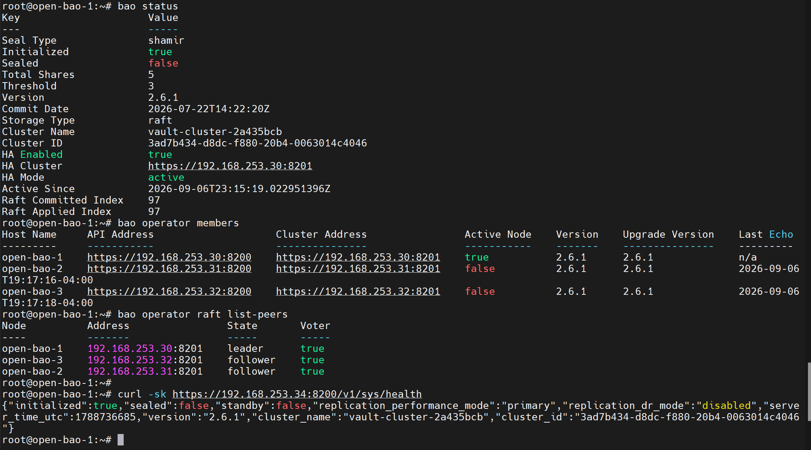
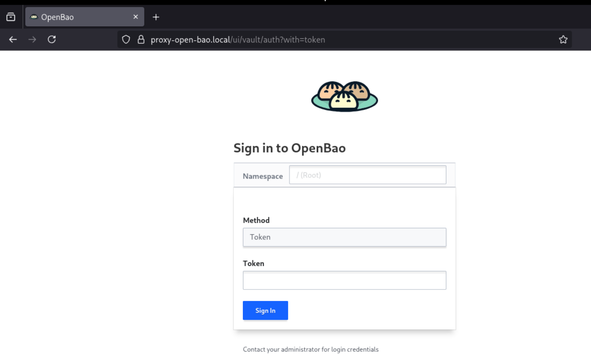

**English** | [Español](./Readme.es.md)

# OpenBao Server - Secrets Management HA


3-node OpenBao cluster (Vault fork) with integrated Raft storage, for centralized secrets management consumed by ArgoCD via AVP.

## Topology

| Node | IP | Role |
|------|-----|------|
| open-bao-1 | 192.168.253.30 | Raft peer |
| open-bao-2 | 192.168.253.31 | Raft peer |
| open-bao-3 | 192.168.253.32 | Raft peer |
| proxy-open-bao | 192.168.253.34 | HAProxy (HA endpoint) |

## Deployment Order

### 1. Install and Configure the Raft Cluster
**Folder**: [`open-bao-1/`](./open-bao-1/)

Installation, init and unseal process — the same procedure for all 3 nodes, changing only IP/hostname:
```bash
cd open-bao-1/
# Follow README.md, repeat in open-bao-2/ and open-bao-3/ with their IP
```

### 2. Configure HAProxy (HA Endpoint)
**Folder**: [`proxy-open-bao/`](./proxy-open-bao/)

Load balancing and health-check so clients always talk to the active leader:
```bash
cd proxy-open-bao/
# Follow README.md
```

## Readiness State

After all the steps you will have:
- **3-node Raft cluster** initialized and unsealed
- **Multi-SAN certificates** valid for Go TLS
- **KV v2** enabled at `secret/`
- **AppRole** configured for ArgoCD
- **HAProxy** providing transparent HA on leader changes





## Next Step

Once the cluster is unsealed and the AppRole configured, go to:
- **`../../infrastructure-applications/argocd/`** - Integration via AVP sidecar
- **`../../infrastructure-applications/argocd-docker-build/`** - Custom image with AVP baked in

## Dependencies

- **Step 1** requires generated certificates (`../../requirements/certificate-server-config/`)
- **Step 2** requires the Raft cluster initialized and unsealed (Step 1)
- **ArgoCD** requires the AppRole configured (Step 1) before it can resolve secrets
