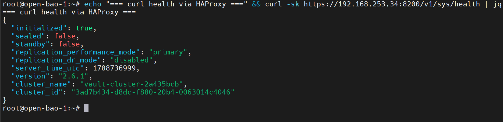

**English** | [Español](./Readme.es.md)

# OpenBao - HAProxy (HA Endpoint)


Load balancer exposing a single HA endpoint for OpenBao, routing traffic only to the active leader of the Raft cluster.

## Specifications

- IP: 192.168.253.34
- Health-check: `/v1/sys/health` — returns HTTP 200 **only** for the leader node
- The other nodes (standby/sealed) return different codes, so HAProxy automatically removes them from the pool

## Deployment Order

### 1. Generate Certificate
**Folder**: [`../../../requirements/certificate-server-config/`](../../../requirements/certificate-server-config/)

Dedicated certificate for the HAProxy endpoint (different from the OpenBao nodes certificate).

### 2. Install HAProxy
```bash
apt install haproxy
```

### 3. Apply Configuration
Copy `haproxy.cfg` from this folder to `/etc/haproxy/haproxy.cfg`:
```bash
systemctl restart haproxy
```

### 4. Point Clients to the Endpoint
In ArgoCD (or other consumers), configure:
```bash
VAULT_ADDR=https://192.168.253.34:8200
```

## Readiness State

After these steps you will have:
- **Single endpoint** (`.34:8200`) always resolving to the active leader
- **Transparent failover** when the Raft leader changes

## Verification

```bash
# Must return 200 only while there is an active leader
curl -k https://192.168.253.34:8200/v1/sys/health

# Force a manual failover and confirm HAProxy keeps answering
bao operator step-down   # from the leader node
curl -k https://192.168.253.34:8200/v1/sys/health
```



## Next Step

- **`../../../infrastructure-applications/argocd/`** - Use this endpoint as `VAULT_ADDR`

## Dependencies

- Requires the OpenBao cluster already initialized (`../open-bao-1/`)
