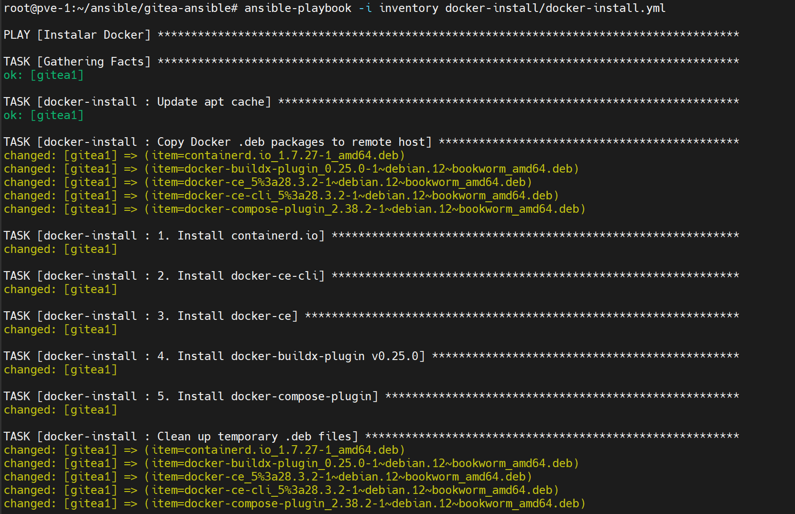

**English** | [Español](./Readme.es.md)

# Docker Install Ansible Role


Offline Docker installation from pre-downloaded .deb files using an Ansible playbook.

## What does it do?

Installs Docker and its components from local .deb files with an Ansible playbook. No internet access or APT repositories required.

### Included components

- containerd.io (1.7.27)
- docker-ce (28.3.2) 
- docker-ce-cli (28.3.2)
- docker-buildx-plugin (0.25.0)
- docker-compose-plugin (2.38.2)

## Usage

```bash
# Run installation
ansible-playbook -i inventory docker-install.yml
```

## Structure

```
docker-install/
├── files/                           # .deb files
│   ├── containerd.io_1.7.27-1_amd64.deb
│   ├── docker-ce_5%3a28.3.2-1~debian.12~bookworm_amd64.deb
│   ├── docker-ce-cli_5%3a28.3.2-1~debian.12~bookworm_amd64.deb
│   ├── docker-buildx-plugin_0.25.0-1~debian.12~bookworm_amd64.deb
│   └── docker-compose-plugin_2.38.2-1~debian.12~bookworm_amd64.deb
└── tasks/main.yml                   # Installation tasks
```

## Verification

```bash
# Check installation
ansible all -i inventory -m shell -a "docker --version"
ansible all -i inventory -m shell -a "docker compose --version"

# Check service
ansible all -i inventory -m shell -a "systemctl status docker"
```


## Updating

To update Docker:
1. Replace the .deb files in `files/`
2. Update the names in `defaults/main.yml` 
3. Run the playbook again
