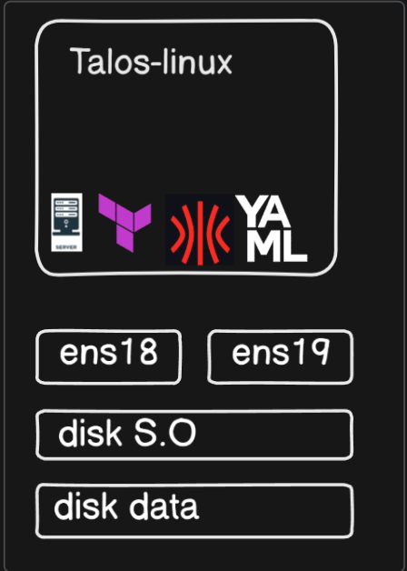

# Talos Linux - Cluster Kubernetes Air-Gapped


Todo lo necesario para levantar el cluster Talos sin acceso a internet: ISO con imágenes cacheadas, installer con system extensions y la configuración de los nodos.



## Contenido

| Carpeta | Propósito | README |
|---------|-----------|--------|
| `talos-base-airgap/` | Genera la ISO de Talos con cache OCI de las imágenes base | [`talos-base-airgap/Readme.md`](./talos-base-airgap/Readme.md) |
| `talos-extensions/` | Genera un installer custom con system extensions, subido a Harbor | [`talos-extensions/Readme.md`](./talos-extensions/Readme.md) |
| `talos-cluster-configs/` | Generación de configs, patches por nodo, bootstrap y kubeconfig | [`talos-cluster-configs/Readme.md`](./talos-cluster-configs/Readme.md) |
| `talos-cluster-configs/customs/` | Patches: base, control plane, workers infra/app, registry mirrors, storage, CNI none | [`customs/Readme.md`](./talos-cluster-configs/customs/Readme.md) |

## Topología

| Nodo | IP | Rol |
|------|-----|-----|
| VIP API | 192.168.253.100 | Endpoint `https://192.168.253.100:6443` |
| control-plane-1 | 192.168.253.101 | Control plane |
| worker-1..n | 192.168.253.111+ | Workers (`workload-type: infrastructure` / `application`) |

Las VMs se crean con Terraform (`../terraform/code/vm-taloscp-infra.tf`, `vm-talosdt-infra.tf`, `vm-talosdt-application.tf`) desde el template 9000.

## Orden de Despliegue

### 1. Generar la ISO air-gapped
```bash
cd talos-base-airgap/
# Seguir README: extraer imágenes → cache OCI → ISO
```

### 2. Generar el installer con extensions
```bash
cd talos-extensions/
# Seguir README: cache → installer → push a Harbor
```

### 3. Configurar y levantar el cluster
```bash
cd talos-cluster-configs/
talosctl gen config promox-cluster https://192.168.253.100:6443 \
  -f --with-docs=false --install-disk /dev/sda --output-dir _out
# Aplicar configs con patches de customs/ (ver comands y README)
talosctl bootstrap --nodes 192.168.253.101
talosctl kubeconfig --nodes 192.168.253.101
```

El cluster arranca **sin CNI** (`cni-none.yaml`); los nodos quedan `NotReady` hasta instalar Cilium.

## Verificación

```bash
talosctl health --nodes 192.168.253.101
```

```bash
kubectl get nodes -o wide
```

## Siguiente Paso

Instalar Gateway API y Cilium desde [`../infrastructure-applications/`](../infrastructure-applications/).

## Dependencias

- Harbor operativo (registry mirrors e installer custom)
- VMs creadas con Terraform
- **Importante**: `_out/` contiene CAs y tokens del cluster, no debe subirse a Git
