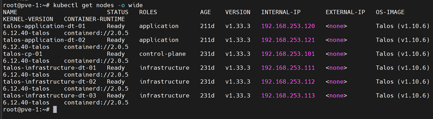

**English** | [Español](./Readme.es.md)

# Talos Cluster Deployment on Proxmox


Full automation to deploy Talos Kubernetes clusters on Proxmox with custom configurations and registry mirrors.

## What is it?

Deploys a Kubernetes cluster using Talos OS on Proxmox infrastructure with modular configuration through YAML patches. Supports local registry mirrors for offline environments.

### Main Benefits

- **Modular configuration**: Reusable patches for different nodes
- **Registry mirrors**: Support for a local Harbor (offline)
- **Custom storage**: Pre-integrated Longhorn configuration
- **Multi-node**: 1 control plane + 2 workers
- **Reproducible**: The same configuration for the whole infrastructure

## Prerequisites

- Proxmox VE with the VMs created
- talosctl CLI installed
- kubectl installed
- Local registry (Harbor) - optional for offline use
- SSH access to the Proxmox nodes

## File Structure

```
.
├── customs/
│   ├── custom.yml                  # Common base configuration
│   ├── controlplane-patch-1.yml    # Control plane patch
│   ├── worker-patch-1.yml          # Worker 1 patch
│   ├── worker-patch-2.yml          # Worker 2 patch
│   ├── storage.yml                 # Longhorn configuration
│   └── registry-mirrors.yml        # Harbor mirrors
└── _out/
    ├── controlplane.yaml           # Generated control plane config
    ├── worker.yaml                 # Generated worker config
    └── talosconfig                 # Cluster credentials
```

## Installation

### 1. Generate the Base Configuration

```bash
talosctl gen config promox-cluster https://192.168.253.100:6443 \
  -f \
  --with-docs=false \
  --install-disk /dev/sda \
  --output-dir _out
```

### 2. Apply the Initial Configuration

#### Control Plane Node
```bash
talosctl apply-config \
  --insecure \
  --nodes 192.168.253.236 \
  --config-patch @customs/custom.yml \
  --config-patch @customs/controlplane-patch-1.yml \
  --config-patch @customs/storage.yml \
  --file _out/controlplane.yaml
```

#### Worker Node 1
```bash
talosctl apply-config \
  --insecure \
  --nodes 192.168.253.239 \
  --config-patch @customs/custom.yml \
  --config-patch @customs/worker-patch-1.yml \
  --config-patch @customs/storage.yml \
  --file _out/worker.yaml
```

#### Worker Node 2
```bash
talosctl apply-config \
  --insecure \
  --nodes 192.168.253.238 \
  --config-patch @customs/custom.yml \
  --config-patch @customs/worker-patch-2.yml \
  --config-patch @customs/storage.yml \
  --file _out/worker.yaml
```

### 3. Configure Cluster Access

```bash
# Export talosconfig
export TALOSCONFIG=_out/talosconfig

# Configure endpoints
talosctl config endpoint 192.168.253.101,192.168.253.100
```

### 4. Bootstrap the Cluster

```bash
talosctl bootstrap -n 192.168.253.101
```

### 5. Get the Kubeconfig

```bash
# From the primary control plane
talosctl kubeconfig -n 192.168.253.101

# Verify access
kubectl get nodes
```

## Configuration

### Cluster Topology

| Node | IP | Role | Patches |
|------|-------|-------------|---------|
| **talos-cp-01** | 192.168.253.101 | Control Plane | custom, controlplane-patch-1, storage |
| **talos-infrastructure-dt-01** | 192.168.253.111 | Infra worker | custom, worker-patch-1, storage |
| **talos-infrastructure-dt-02** | 192.168.253.112 | Infra worker | custom, worker-patch-2, storage |
| **talos-infrastructure-dt-03** | 192.168.253.113 | Infra worker | custom, worker-patch-3, storage |
| **talos-application-dt-01** | 192.168.253.120 | App worker | custom, worker-patch-5, storage |
| **talos-application-dt-02** | 192.168.253.121 | App worker | custom, worker-patch-6, storage |



### Available Patches

```yaml
customs/
├── custom.yml              # Hostname, timezone, NTP
├── controlplane-patch-1    # Control plane config
├── worker-patch-1          # Worker 1 config
├── worker-patch-2          # Worker 2 config
├── storage.yml             # Longhorn storage
└── registry-mirrors.yml    # Harbor mirrors
```

## Usage

### Upgrade Nodes

```bash
# Upgrade workers
talosctl upgrade --nodes 192.168.253.111,192.168.253.112 \
  --image registry.harbor.local/docker-images/installer-base:v1.10.6
```

### Apply Registry Mirrors

#### Control Plane
```bash
talosctl apply-config \
  --nodes 192.168.253.101 \
  --config-patch @customs/custom.yml \
  --config-patch @customs/controlplane-patch-1.yml \
  --config-patch @customs/registry-mirrors.yml \
  --config-patch @customs/storage.yml \
  --file _out/controlplane.yaml
```

#### Workers
```bash
# Worker 1
talosctl apply-config \
  --nodes 192.168.253.111 \
  --config-patch @customs/custom.yml \
  --config-patch @customs/worker-patch-1.yml \
  --config-patch @customs/registry-mirrors.yml \
  --config-patch @customs/storage.yml \
  --file _out/worker.yaml

# Worker 2
talosctl apply-config \
  --nodes 192.168.253.112 \
  --config-patch @customs/custom.yml \
  --config-patch @customs/worker-patch-2.yml \
  --config-patch @customs/registry-mirrors.yml \
  --config-patch @customs/storage.yml \
  --file _out/worker.yaml
```

## Administration

### Verification

```bash
# Cluster health
talosctl health --nodes 192.168.253.101

# Kubernetes nodes
kubectl get nodes

# Check extensions
talosctl get extensions --nodes 192.168.253.101

# System logs
talosctl logs --nodes 192.168.253.101
```

### Useful Commands

```bash
# Talos dashboard
talosctl dashboard --nodes 192.168.253.101

# Shell on a node
talosctl shell --nodes 192.168.253.101

# Reboot a node
talosctl reboot --nodes 192.168.253.111

# Full reset (DESTRUCTIVE!)
talosctl reset --nodes 192.168.253.111
```

## Full Workflow

```bash
# 1. Generate configs
talosctl gen config promox-cluster https://192.168.253.100:6443 -f --with-docs=false --install-disk /dev/sda --output-dir _out

# 2. Apply configs (control plane + workers)
talosctl apply-config --insecure --nodes 192.168.253.236 --config-patch @customs/custom.yml --config-patch @customs/controlplane-patch-1.yml --config-patch @customs/storage.yml --file _out/controlplane.yaml
talosctl apply-config --insecure --nodes 192.168.253.239 --config-patch @customs/custom.yml --config-patch @customs/worker-patch-1.yml --config-patch @customs/storage.yml --file _out/worker.yaml
talosctl apply-config --insecure --nodes 192.168.253.238 --config-patch @customs/custom.yml --config-patch @customs/worker-patch-2.yml --config-patch @customs/storage.yml --file _out/worker.yaml

# 3. Configure access
export TALOSCONFIG=_out/talosconfig
talosctl config endpoint 192.168.253.101,192.168.253.100

# 4. Bootstrap
talosctl bootstrap -n 192.168.253.101

# 5. Kubeconfig
talosctl kubeconfig -n 192.168.253.101
```

## Troubleshooting

| Problem | Solution |
|----------|----------|
| **Node not responding** | Check IP and connectivity: `ping 192.168.253.101` |
| **Bootstrap fails** | Wait 2-3 min, check logs: `talosctl logs -n 192.168.253.101` |
| **Upgrade stuck** | Reboot the node: `talosctl reboot -n <NODE_IP>` |
| **Registry not working** | Check the mirrors in: `talosctl get machinestatus -n <NODE_IP>` |

## Limitations

| Scenario | Functionality |
|-----------|---------------|
| **With internet** | Direct pull from ghcr.io |
| **Without internet** | Requires Harbor with mirrors |
| **Versions** | Talos v1.10.6+ recommended |
| **Storage** | Requires extra disks for Longhorn |
