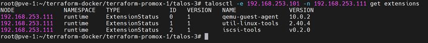

**English** | [Español](./Readme.es.md)

# Talos Custom Installer Builder


Tool to build custom Talos installers with system extensions included, for offline use.

## What is it?

Builds Talos installers with system extensions (iscsi-tools, util-linux-tools, qemu-guest-agent) preinstalled. Ideal for environments without internet or with a local registry.

### Main Benefits

- **Offline use**: Works without internet access using a local registry
- **Preinstalled extensions**: iscsi-tools, util-linux-tools, qemu-guest-agent included
- **Optimized cache**: Images in an OCI cache for fast builds
- **Simplified upgrades**: A single command to update nodes
- **Reproducible**: The same installer for the whole infrastructure

## Prerequisites

- Docker installed
- Internet access (initial build only)
- talosctl CLI
- Local registry (Harbor recommended for offline use)

## File Structure

```
~/talos-images-tools/
├── images.txt              # Image list for the cache
├── image-cache.oci/        # Generated image cache
└── _out/                   # Output files
    └── installer-amd64.tar # Custom installer
```

## Installation

### 1. Prepare the Workspace

```bash
mkdir ~/talos-images-tools
cd ~/talos-images-tools
```

### 2. Create the Image Cache

```bash
# Required image list
cat > images.txt << EOF
ghcr.io/siderolabs/flannel:v0.26.7
registry.k8s.io/coredns/coredns:v1.12.1
gcr.io/etcd-development/etcd:v3.5.21
registry.k8s.io/kube-apiserver:v1.33.3
registry.k8s.io/kube-controller-manager:v1.33.3
registry.k8s.io/kube-scheduler:v1.33.3
registry.k8s.io/kube-proxy:v1.33.3
ghcr.io/siderolabs/kubelet:v1.33.3
ghcr.io/siderolabs/installer:v1.10.6
registry.k8s.io/pause:3.10
ghcr.io/siderolabs/qemu-guest-agent:10.0.2@sha256:0d16cd4f8cefab33f091e336bc666943a71355ee010d0dfa0e46498693af1c52
ghcr.io/siderolabs/util-linux-tools:2.40.4@sha256:f305315aec4fe0a355fb933c919a25550c67785acb193ee2842784317b5fa66b
ghcr.io/siderolabs/iscsi-tools:v0.2.0@sha256:f2d78a7f19d301f2bf88ec99d948ffc63778125ce3acb0146049b75ed7ecd18c
EOF
```
```
cat images.txt | talosctl images cache-create --image-cache-path ./image-cache.oci --images=-
```
```
# Build the OCI cache
docker run --rm -v $PWD/image-cache.oci:/image-cache.oci \
  ghcr.io/siderolabs/imager:v1.10.6 image-cache \
  --images @images.txt \
  --output /image-cache.oci
```

### 3. Build the Custom Installer

```bash
docker run --rm -t \
  -v $PWD/_out:/out \
  -v $PWD/image-cache.oci:/image-cache.oci:ro \
  ghcr.io/siderolabs/imager:v1.10.6 installer \
  --arch amd64 \
  --system-extension-image ghcr.io/siderolabs/qemu-guest-agent:10.0.2@sha256:0d16cd4f8cefab33f091e336bc666943a71355ee010d0dfa0e46498693af1c52 \
  --system-extension-image ghcr.io/siderolabs/util-linux-tools:2.40.4@sha256:f305315aec4fe0a355fb933c919a25550c67785acb193ee2842784317b5fa66b \
  --system-extension-image ghcr.io/siderolabs/iscsi-tools:v0.2.0@sha256:f2d78a7f19d301f2bf88ec99d948ffc63778125ce3acb0146049b75ed7ecd18c \
  --image-cache /image-cache.oci
```

## Configuration

### Default Variables

```yaml
# Included system extensions
qemu-guest-agent: v10.0.2
util-linux-tools: v2.40.4
iscsi-tools: v0.2.0

# Architecture
arch: amd64

# Talos version
talos_version: v1.10.6
```

### Local Registry (for offline use)

```bash
# Load the image into Docker
cd _out/
docker load -i installer-amd64.tar

# Tag it for the local registry
docker tag ghcr.io/siderolabs/installer-base:v1.10.6 \
  registry.harbor.local/docker-images/installer-base:v1.10.6

# Push to Harbor
docker push registry.harbor.local/docker-images/installer-base:v1.10.6
```

## Usage

### Upgrade Talos Nodes

```bash
# Upgrade a single node
talosctl upgrade --nodes 192.168.253.101 \
  --image registry.harbor.local/docker-images/installer-base:v1.10.6

# Upgrade multiple nodes
talosctl upgrade --nodes 192.168.253.101,192.168.253.111,192.168.253.112 \
  --image registry.harbor.local/docker-images/installer-base:v1.10.6
```

### Verification

```bash
# Check active extensions
talosctl get extensions --nodes 192.168.253.101

# Node status
talosctl get machinestatus --nodes 192.168.253.101
```

## Administration

```bash
# Check the loaded image
docker images | grep installer

# List generated files
ls -la _out/

# Show cache disk usage
du -sh image-cache.oci/
```

## Command Summary

```bash
# Full build
mkdir ~/talos-images-tools && cd ~/talos-images-tools

# 1. Cache
docker run --rm -v $PWD/image-cache.oci:/image-cache.oci ghcr.io/siderolabs/imager:v1.10.6 image-cache --images @images.txt --output /image-cache.oci

# 2. Installer
docker run --rm -t -v $PWD/_out:/out -v $PWD/image-cache.oci:/image-cache.oci:ro ghcr.io/siderolabs/imager:v1.10.6 installer --arch amd64 --system-extension-image ghcr.io/siderolabs/qemu-guest-agent:10.0.2@sha256:... --image-cache /image-cache.oci

# 3. Deploy
docker load -i _out/installer-amd64.tar
talosctl upgrade --nodes <NODE_IP> --image <INSTALLER_IMAGE>
```



## Limitations

| Scenario | Functionality |
|----------|---------------|
| **With internet** | Fully functional |
| **Without internet** | Only with a local registry |
| **Versions** | SHAs must match the Talos version |
