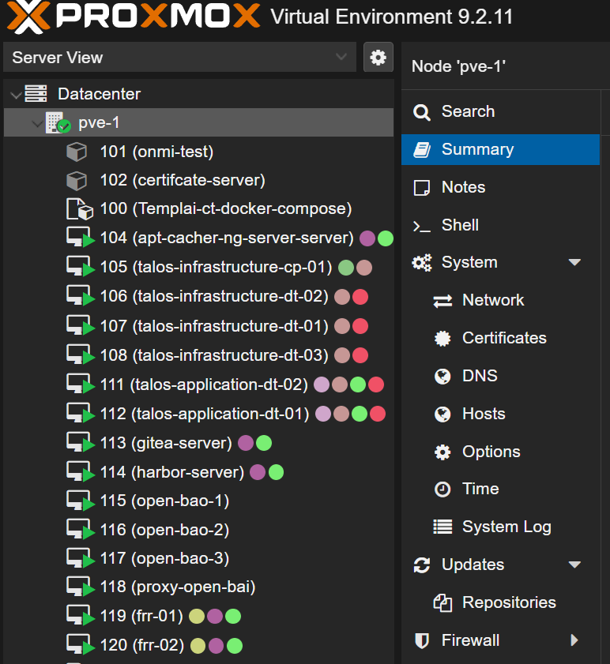

# Terraform - Provisión de VMs en Proxmox


Crea las VMs del entorno en Proxmox con el provider BPG (`proxmox_virtual_environment_vm`), clonando desde templates.

## Contenido

| Carpeta | Propósito | README |
|---------|-----------|--------|
| `proxmox-connection/` | Conexión a la API de Proxmox con la imagen Docker air-gapped `andherson1039/terraform-complete-airgap:2.0` (providers ya incluidos) | [`proxmox-connection/Readme.md`](./proxmox-connection/Readme.md) |
| `code/` | Definición de las VMs y sus variables | [`code/Readme.md`](./code/Readme.md) |

## VMs que crea `code/`

| Archivo | VM | Template |
|---------|----|----------|
| `vm-apt-ng.tf` | apt-cacher-ng | 8001 |
| `vm-harbor.tf` | Harbor | 8001 |
| `vm-gitea.tf` | Gitea | 8001 |
| `vm-gitea-runners.tf` | Gitea runners (`gitea_count_runners`) | 8000 |
| `vm-taloscp-infra.tf` | Talos control plane (`control_plane_count`) | 9000 |
| `vm-talosdt-infra.tf` | Talos workers infra (`infra_worker_count`) | 9000 |
| `vm-talosdt-application.tf` | Talos workers app (`app_worker_count`) | 9000 |

Los conteos se ajustan en `code/terraform.tfvars`.

## Orden de Despliegue

### 1. Verificar la conexión
```bash
cd proxmox-connection/
docker compose run --rm terraform init
docker compose run --rm terraform validate
```

### 2. Crear las VMs
```bash
cd ../code/
terraform init
terraform plan
terraform apply
```

## Verificación

```bash
terraform state list
```



## Dependencias

- Token de API de Proxmox (`../requirements/proxmox-api-token/`)
- Bundle Terraform air-gapped (`../requirements/terraform-images/`)
- Templates 8000, 8001 y 9000 creados en Proxmox (`../requirements/debian12-templates/`, `../talos-linux/`)
