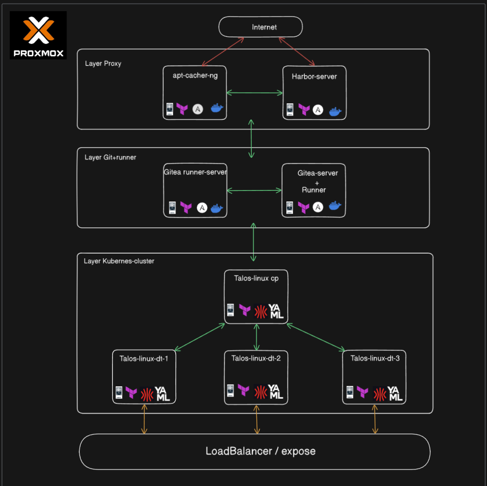
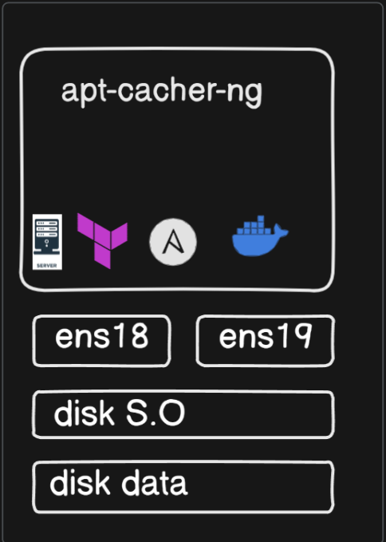
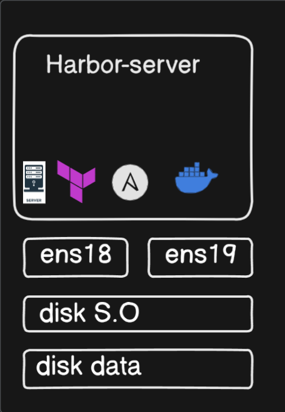
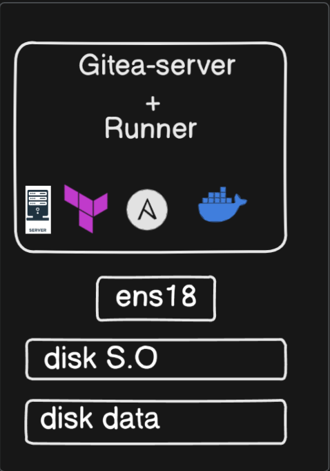
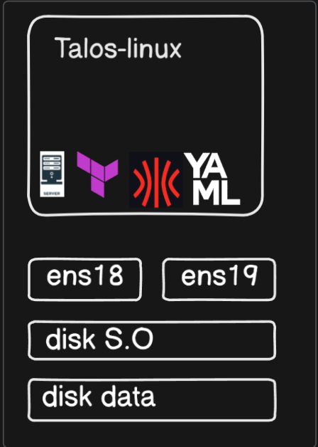

**English** | [Español](./Readme.es.md)

# Terraform Proxmox Infrastructure


Full Proxmox infrastructure with Terraform for the Talos Kubernetes cluster and its support services.

## What does it do?

Automatically deploys a 3-layer infrastructure on Proxmox: proxy services (apt-cacher-ng, harbor), git services (gitea + runners) and a Kubernetes cluster with Talos Linux. Includes dual network configuration (vmbr0/vmbr1) and provisioning optimized for offline environments.

## Architecture



**Infrastructure layers:**
- **Proxy layer**: apt-cacher-ng + harbor-server (internet access)
- **Git+Runner layer**: gitea-server + runners (CI/CD)
- **Kubernetes layer**: Talos cluster (1 CP + variable workers)






**Main features:**
- **Full automation**: Deploy with a single command
- **Layered architecture**: Clear separation of responsibilities
- **Scalability**: Variable workers per workload type
- **Offline optimization**: apt-cacher-ng and harbor included

## Available Services

| Service | Purpose | VMs | Networks |
|---------|---------|-----|----------|
| **apt-cacher-ng** | Debian/Ubuntu package cache | 1 | vmbr0 + vmbr1 |
| **harbor** | Private Docker/OCI registry | 1 | vmbr0 + vmbr1 |
| **gitea** | Git server with CI/CD | 1 + runners | vmbr1 |
| **talos-cp** | Kubernetes control plane | 1 | vmbr1 + vmbr2 |
| **talos-infra** | Infrastructure workers | 3 | vmbr1 + vmbr2 |
| **talos-app** | Application workers | 2 | vmbr1 + vmbr2 |

## Prerequisites

- Proxmox VE with templates configured
- Terraform >= 1.0
- Available templates: 8000, 8001 (Ubuntu), 9000 (Talos)
- Proxmox API token configured

## Configuration

### Main Variables

```hcl
# terraform.tfvars
cluster_name = "talos-infrastructure"
control_plane_count = 1
infra_worker_count = 3
app_worker_count = 2
gitea_count_runners = 0
```

### Required Templates

| Template ID | Purpose | Base image |
|-------------|---------|------------|
| 8000 | Gitea runners | Debian12 |
| 8001 | Base services | Debian12 |
| 9000 | Talos cluster | Talos Linux |

## Implementation Order

### 1. Prepare the Configuration

```bash
# Clone the repository
git clone <repo-url>
cd terraform-promox-1

# Configure variables
cp terraform.tfvars.example terraform.tfvars
vim terraform.tfvars
```

### 2. Validate and Plan

```bash
# Initialize Terraform
terraform init

# Validate configuration
terraform validate

# Show the execution plan
terraform plan
```

### 3. Deploy the Infrastructure

```bash
# Apply configuration
terraform apply

# Confirm with 'yes' when prompted
```

## Verification

```bash
# Deployment state
terraform show

# List created VMs
terraform state list | grep proxmox_virtual_environment_vm

# Check on Proxmox
qm list | grep -E "(apt-cacher|harbor|gitea|talos)"
```

## Customization

To change VM resources, edit:
- `vm-*.tf` - Per-service configuration
- `terraform.tfvars` - Instance counts
- `provider.tf` - Proxmox configuration

### Scaling Workers

```hcl
# Increase infrastructure workers
infra_worker_count = 3

# Enable application workers
app_worker_count = 2

# Add gitea runners
gitea_count_runners = 2
```

### Storage Configuration

Every VM uses a dual-disk layout:
- **scsi0**: Operating system disk (20GB)
- **scsi1**: Data/application disk (20GB)
- **Datastore**: local-lvm with discard enabled
- **Format**: raw for better performance

## Administration

```bash
# Destroy the infrastructure
terraform destroy

# Update a single service
terraform apply -target=proxmox_virtual_environment_vm.harbor_server

# Show outputs
terraform output
```

## Network Architecture

| Interface | Network | Purpose |
|-----------|---------|---------|
| **vmbr0** | External | Internet access (proxy layer) |
| **vmbr1** | Internal | Service communication |
| **vmbr2** | Cluster | Talos Kubernetes network |
