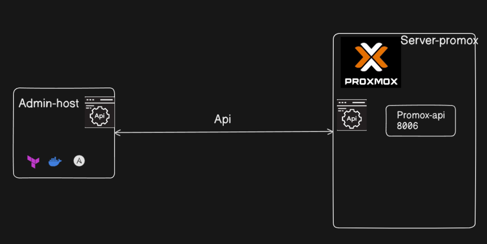
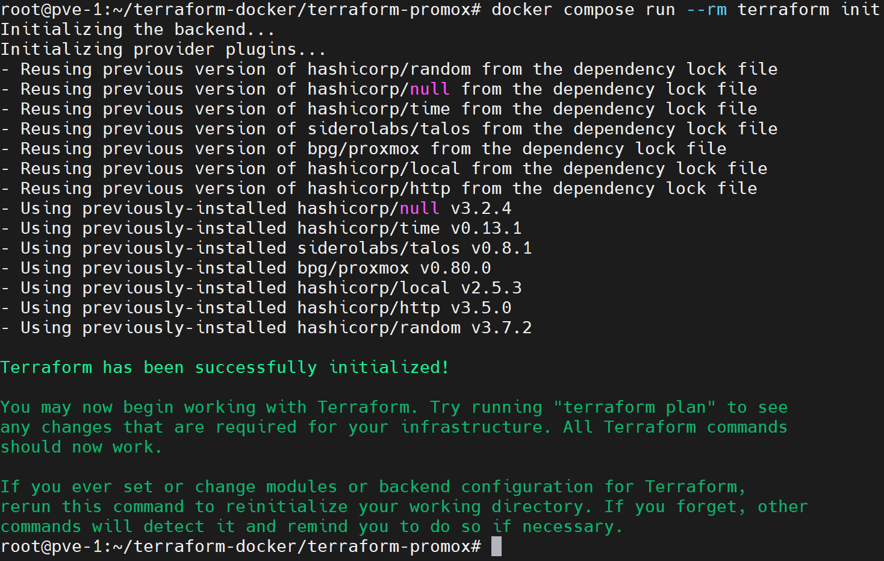

**English** | [Español](./Readme.es.md)

# Terraform Proxmox Connection


## Part of the project: Enterprise Infrastructure

This module handles the **base connection** between Terraform and Proxmox VE via Docker for automated infrastructure deployment.


## Architecture 



## Features

- **Airgap image**: `andherson1039/terraform-complete-airgap:2.0` with every provider bundled
- **API connection**: Token and endpoint configuration for Proxmox VE
- **Flexible variables**: Control nodes, cluster and settings via `.env`
- **Scaling**: Add/remove VMs by changing variables

## Module Structure

```
terraform/
├── docker-compose.yml          # Docker services configuration
├── .env                        # Connection environment variables
├── provider.tf                 # Required providers and versions
├── variables.tf                # Variable definitions
```

## Requirements

- Docker Engine 20.10+
- Docker Compose v2.39+
- Proxmox VE 7.0+ with the API enabled
- Proxmox API token configured (see `requirements/proxmox-api-token/`)
- Network reachability between the Docker host and Proxmox

## Configuration

### 1. Configure environment variables

Create the `.env` file with your Proxmox configuration:

```bash
# TF_VAR_* variables always work inside Docker
TF_VAR_proxmox_endpoint=https://192.168.1.100:8006
TF_VAR_proxmox_api_token=terraform@pam!terraform=xxxxxxxx-xxxx-xxxx-xxxx-xxxxxxxxxxxx
TF_VAR_proxmox_insecure=true
TF_VAR_node_name=pve-1
```

### 2. Check the Docker image

```bash
# Make sure the image is available
docker pull andherson1039/terraform-complete-airgap:2.0
```

## Verify the Connection

### Test Proxmox connectivity

```bash
# Check that the Proxmox API responds
curl -k https://192.168.1.100:8006/api2/extjs/access/domains

# Test the connection from the container
docker compose run --rm terraform bash -c "curl -k \$TF_VAR_proxmox_endpoint/api2/extjs/version"
```

### Validate the Terraform configuration

```bash
# Initialize and validate the configuration
docker compose run --rm terraform init
docker compose run --rm terraform validate
```



## Usage

### Initialize Terraform

```bash
# Start the container and initialize
docker compose run --rm terraform init
```

### Plan the deployment

```bash
# Show proposed changes
docker compose run --rm terraform plan
```

### Apply the infrastructure

```bash
# Apply changes
docker compose run --rm terraform apply
```

### Scale the cluster

```bash
# Change variables in .env or use an override
TF_VAR_control_plane_count=3 TF_VAR_worker_count=2 docker compose run --rm terraform apply
```

### Destroy resources

```bash
# Remove all the infrastructure
docker compose run --rm terraform destroy
```

## Environment Variables

| Variable | Description | Example | Default |
|----------|-------------|---------|---------|
| `TF_VAR_proxmox_endpoint` | Proxmox API URL | `https://192.168.1.100:8006` | - |
| `TF_VAR_proxmox_api_token` | Proxmox API token | `terraform@pam!terraform=xxxxxxxx...` | - |
| `TF_VAR_proxmox_insecure` | Allow invalid SSL certificates | `true` or `false` | `true` |
| `TF_VAR_node_name` | Target Proxmox node name | `pve-1` | `pve-1` |

## Included Providers

- **proxmox** (bpg/proxmox ~> 0.80.0) - VM management on Proxmox
- **talos** (siderolabs/talos ~> 0.8.0) - Talos Linux configurations
- **local, http, random, null, time** - Helper providers

## Troubleshooting

### Connection error

```bash
# Check basic connectivity
ping 192.168.1.100

# Test the API manually
curl -k https://192.168.1.100:8006/api2/extjs/version
```

### Invalid token

```bash
# Check that the token exists in Proxmox
# Datacenter → API Tokens → check terraform@pam!terraform
```

### Clean state

```bash
# Clean the Terraform state
docker compose run --rm terraform bash -c "rm -rf .terraform .terraform.lock.hcl"
docker compose run --rm terraform init
```
